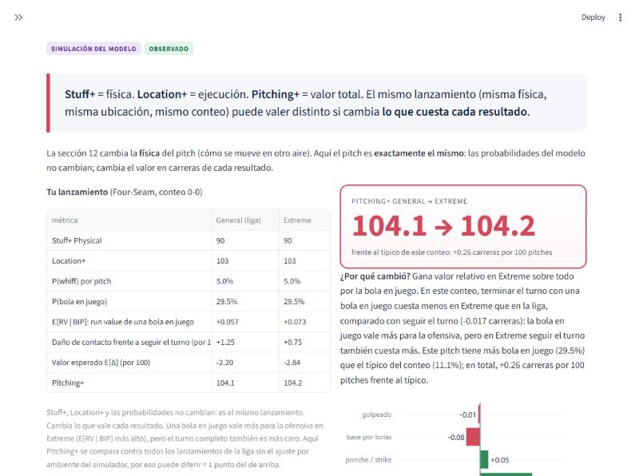
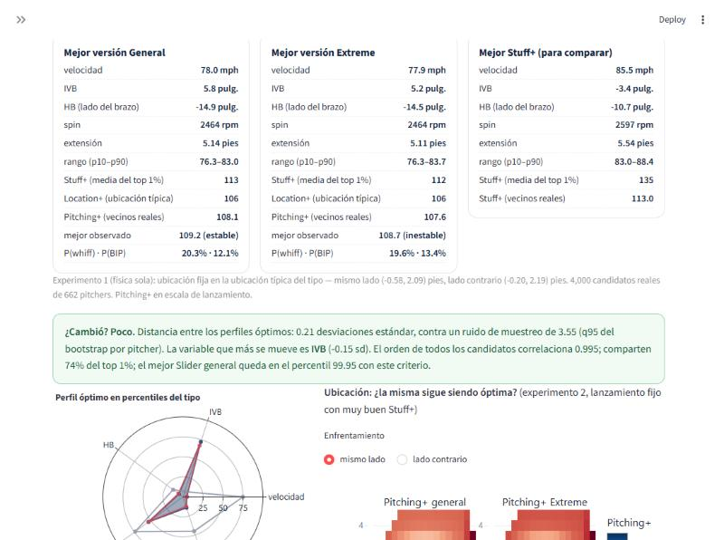
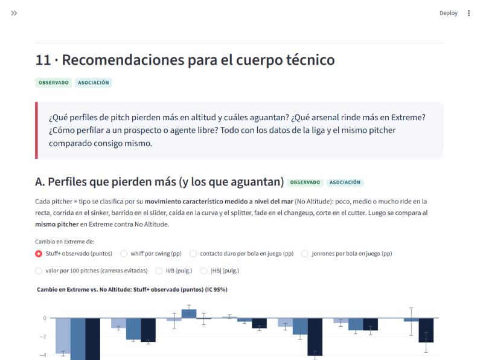
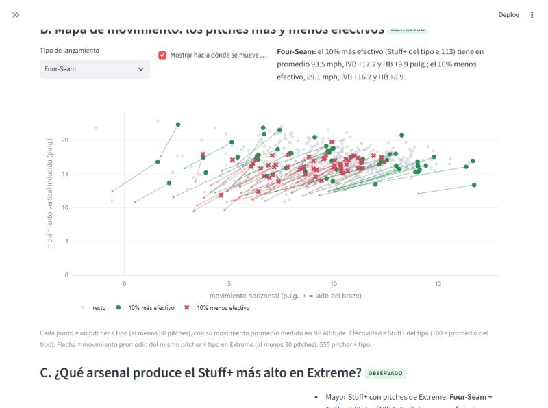
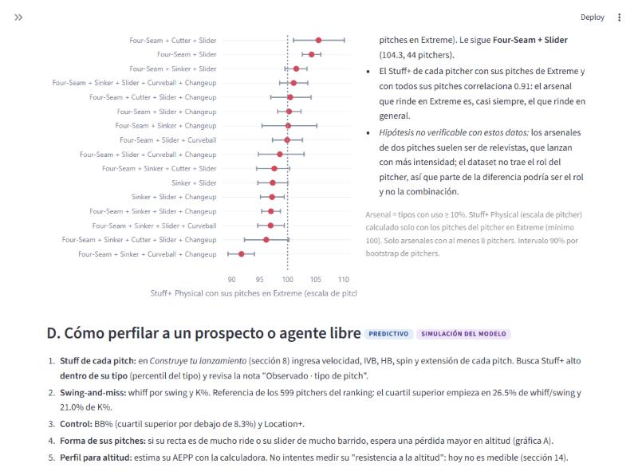
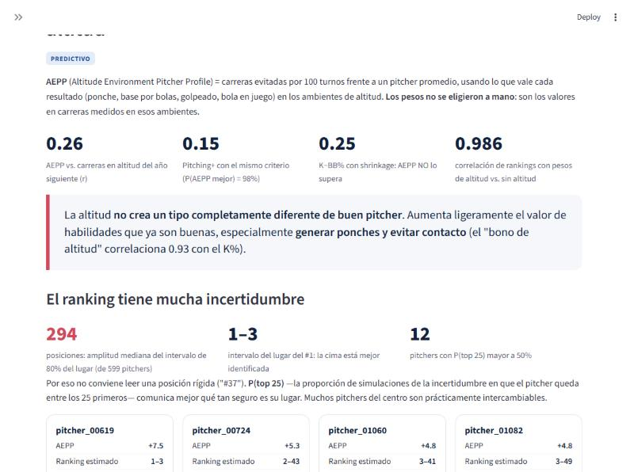
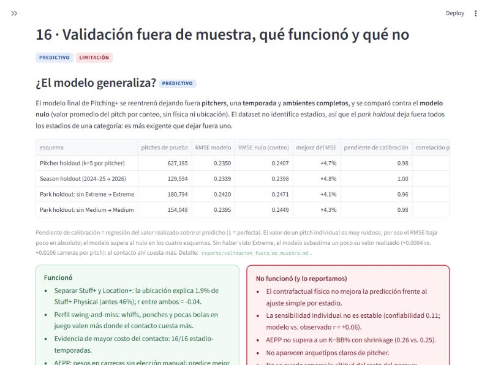

# Pitching+ para ambientes de altitud

Métricas de calidad de pitcheo (**Stuff+ Physical**, **Location+** y **Pitching+**) construidas con datos Trackman anónimos de la LMB
para responder:

> ¿Qué cambia cuando lanzar en altitud extrema hace más caro permitir contacto, y qué pitchers, pitches y arsenales convienen
> en ese ambiente?

> **Sobre los nombres.** El reto plantea sus preguntas para la altitud de la Ciudad de México. El dataset está anonimizado: para
> cada juego solo dice si fue en **No Altitude**, **Medium** o **Extreme Altitude**. Respondemos con la categoría **Extreme Altitude**
> (condiciones de altitud extrema como las de la Ciudad de México) sin identificar qué estadio es cuál: los estadios se reconstruyen
> como grupos anónimos `ANON_STADIUM_xx` solo con los datos, y dentro de Extreme hay varios distintos. No se usa información externa.

## Entregables del reto: dónde está cada uno

La página es `web/app.py` (Streamlit). Los números de sección son los de la página.

| entregable | en la página | archivos |
|---|---|---|
| **1. Stuff+, Location+ y Pitching+ por pitch** | 13 · Ficha del pitcher, "Score de cada lanzamiento" (cada lanzamiento real, filtrable y descargable); 8 · Construye tu lanzamiento (cualquier pitch); 4, 5 y 7 (cómo se calculan) | `data/web/pitch_scores.parquet`, `src/analysis/pitch_scores.py`, `web/engine.py` |
| **1. Agregación por pitcher y por repertorio** | 13 · Ranking y ficha del pitcher (Stuff+ y Location+ por tipo) | `data/web/pitcher_altitude_profiles.csv`, `pitcher_pitch_types.csv` |
| **1. ¿Qué arsenal produce el Stuff+ más alto en altitud?** | 11 · Recomendaciones, parte C | `data/web/arsenal_altitude.csv` |
| **1. Altitud vs. nivel del mar (efecto cuantificado)** | 1 · Evidencia, 6 · Tipos de lanzamiento, 9 · Pitching+ general vs. altitud, 12 · Compara ambientes | `reports/p2_pitcher_profiles_altitude.md` |
| **2. Perfil físico ideal** | 10 · ¿Es el mismo un buen lanzamiento?, 11 · Recomendaciones (A y C) | `reports/optimal_pitch_by_environment.md` |
| **2. Argumentación física y estadística** | 2 · El contacto cuesta más, 3 · Qué buscamos, 15 · Física | `reports/documento_tecnico.pdf` §2 y §6 |
| **3. Perfiles que ganan o pierden en altitud (contacto duro y jonrón)** | 11 · Recomendaciones, parte A; 6 · Tipos de lanzamiento | `data/web/pitch_shape_altitude_effects.csv` |
| **3. Cómo perfilar un prospecto o agente libre** | 11 · Recomendaciones, parte D (flujo y calculadora de AEPP) | `data/web/prospect_reference.json` |
| **4. Simulador para el pitching coach** | 8 · Construye tu lanzamiento | `web/engine.py` |
| **4. El mismo pitch en altitud vs. nivel del mar, lado a lado** | 9 (costo de los resultados) y 12 (física) | `reports/pitching_plus_general_vs_altitude.md` |
| **4. Mapa de movimiento de los pitches más y menos efectivos** | 11 · Recomendaciones, parte B | `data/web/movement_map.csv` |
| **5. Documento técnico (6–10 páginas)** | — | [`reports/documento_tecnico.pdf`](reports/documento_tecnico.pdf) (también `.md`) |
| **Validación fuera de muestra (pitcher, season y park holdout)** | 16 · Validación | [`reports/validacion_fuera_de_muestra.md`](reports/validacion_fuera_de_muestra.md) |
| **Para presentar** | — | [`reports/guia_para_presentacion.md`](reports/guia_para_presentacion.md) |

## Resultados clave

- En Extreme, comparando al mismo pitcher contra el mismo bateador: whiff por swing −2.9 pp, ponche por turno −4.7 pp y +0.068 carreras
  por bola en juego, en 16 de 16 combinaciones estadio anónimo × temporada. Cambiar una bola en juego por un ponche vale ≈ 27% más.
- El modelo final supera al modelo nulo por conteo y está calibrado en pitcher, season y park holdout.
- El perfil favorable es el de swing-and-miss; la altitud premia más lo que ya era bueno (ranking con pesos de altitud vs. nivel del
  mar: correlación 0.986).
- Los pitches que más dependen del giro (mucho ride, barrido, caída o fade) son los que más pierden en altitud.
- Un gran lanzamiento sigue siendo un gran lanzamiento: el óptimo de cada tipo casi no cambia con el ambiente.

## Cómo verlo y correrlo

```bash
.venv\Scripts\streamlit run web/app.py           # página (también desplegable en Streamlit Community Cloud: web/app.py)
.venv\Scripts\python -m pytest tests             # pruebas
.venv\Scripts\python -m src.pipeline              # todo el pipeline desde los datos crudos (requiere data/raw)
.venv\Scripts\python -m src.pipeline --from web_data   # solo regenerar los datos de la página y los documentos
```

La página no entrena modelos: usa los artefactos de `src/models/artifacts/` (`pitching_plus_v3.pkl`, `stuff_plus_physical.pkl`,
`location_plus_v2.pkl`) y las tablas de `data/web/`. Ninguna cifra de la página está escrita a mano. Dependencias de la página:
`web/requirements.txt`; del pipeline completo: `requirements.txt` (versiones exactas en `requirements-lock.txt`).

## Estructura del repositorio

```
.
├── web/                  # página final (Streamlit): app.py, engine.py (simulador), charts.py, style.css
├── src/
│   ├── data/             # limpieza y estadios anónimos
│   ├── features/         # targets (RE24), física de la trayectoria, arsenal
│   ├── models/           # Stuff+ Physical, Location+ v2, Pitching+ (cadena de probabilidades) y versiones anteriores
│   ├── analysis/         # efectos de altitud, perfiles (AEPP), óptimo por ambiente, entregables
│   ├── validation/       # splits, baselines, validación temporal y fuera de muestra
│   ├── reports/          # generadores de reportes, datos de la página y documento técnico
│   └── pipeline.py       # corre todo en orden y escribe reports/pipeline_run.md
├── data/web/             # tablas derivadas y anónimas que usa la página
├── reports/              # documento técnico, guía, reportes de cada fase, figuras y capturas
├── historial/            # material de fases anteriores (ver historial/README.md)
├── dashboard/scoring.py  # funciones de puntuación que usa el simulador
└── tests/                # pruebas (pytest)
```

## Datos y confidencialidad

El repositorio no incluye los datos crudos ni procesados (`data/raw`, `data/processed`). Solo incluye las tablas derivadas y anónimas
de `data/web/` y tres agregados pequeños de `data/processed/` que necesita la página publicada.

## Herramientas, librerías e IA

- **IA generativa:** usamos Claude (Anthropic) como asistente para escribir código y redactar textos (documentos, reportes y página). El
  planteamiento, las decisiones de modelado y la revisión de los resultados son del equipo; todas las cifras salen del pipeline
  reproducible y las pruebas de `tests/` revisan que los textos citen los números actuales.
- **Librerías de código abierto:** LightGBM (modelos), scikit-learn (validación y métricas), Optuna (ajuste de hiperparámetros), pandas,
  NumPy, PyArrow y SciPy (datos y estadística), Streamlit y Plotly (página), Matplotlib (figuras) y pytest (pruebas). En los
  análisis exploratorios archivados en `historial/` también se usaron SHAP, PyMC y EconML. Versiones exactas en `requirements-lock.txt`.
- **Literatura:** las referencias de física del béisbol, sabermetría y métodos están en el documento técnico.
- **Datos:** solo el dataset Trackman anónimo del hackathon; ninguna fuente externa.

## Documentos de respaldo

- Fases del proyecto: `reports/p0_altitude_pipeline.md` (estadios anónimos y baselines), `reports/hipotesis_altitud.md` (efectos de
  altitud), `reports/p2_pitcher_profiles_altitude.md` (métricas y perfiles).
- Auditoría matemática: `reports/auditoria_matematica.md`. Bitácora completa: `reports/resultados_finales.md` §7.
- Página: `reports/web_architecture_plan.md` y `reports/web_final_validation.md`; capturas en `reports/capturas_web/`.

## Capturas

Las 42 capturas de la página completa están en [`reports/capturas_web/`](reports/capturas_web/). Algunas clave:

**Inicio**


**Simulador: Stuff+, Location+, Pitching+ y el desglose P(BIP) × E[RV | BIP]**

![Simulador: Stuff+, Location+, Pitching+ y el desglose P(BIP) × E[RV | BIP]](reports/capturas_web/17_s08_simulador_c_por_que.jpg)

**El mismo pitch con los costos de la liga y los de Extreme**



**Lanzamiento óptimo por ambiente**



**Perfiles que pierden más en altitud**



**Mapa de movimiento**



**Arsenales y perfil de prospecto**



**Ranking AEPP con incertidumbre**



**Validación fuera de muestra**


