# Pitching+ para ambientes de altitud

## Objetivo

Construir métricas de calidad de pitcheo (**Stuff+ Physical**, **Location+** y **Pitching+**) a partir de datos
Trackman anónimos de una liga que juega en ambientes de altitud muy distintos, y usarlas para responder:

> ¿Qué cambia cuando lanzar en altura hace más caro permitir contacto, y qué pitchers tienen el perfil más
> favorable para esos ambientes?

La menor densidad del aire en altitud reduce el drag y el efecto Magnus: los pitches se mueven menos y la pelota
bateada vuela más. Un modelo que ignore el ambiente premia o castiga a los pitchers según dónde lanzaron.

> **Anonimización.** El dataset no identifica estadios, equipos ni pitchers. Solo trae una categoría de altitud por
> juego (No / Medium / Extreme). Los estadios se reconstruyen como grupos anónimos `ANON_STADIUM_xx`
> (`src/data/parks.py`) usando únicamente los datos; no se usa información externa ni se intenta identificar
> estadios, equipos o pitchers reales. "Extreme" agrupa varios estadios con densidades efectivas distintas.

## La página web y el reporte

- **Reporte principal:** [`reports/p2_pitcher_profiles_altitude.md`](reports/p2_pitcher_profiles_altitude.md) (perfiles de pitcher para ambientes de altitud).
- **Resultados y bitácora:** [`reports/resultados_finales.md`](reports/resultados_finales.md) · Auditoría: [`reports/auditoria_matematica.md`](reports/auditoria_matematica.md).
- **Página:** `web/app.py` (Streamlit). Plan: [`reports/web_architecture_plan.md`](reports/web_architecture_plan.md) · Validación: [`reports/web_final_validation.md`](reports/web_final_validation.md).
- **Capturas de toda la página, sección por sección:** [`reports/capturas_web/`](reports/capturas_web/).

> Este repositorio no incluye los datos crudos ni procesados (`data/raw`, `data/processed`). Solo incluye lo que necesita la página publicada: las tablas derivadas y anónimas de `data/web/` y tres agregados pequeños de `data/processed/`. La página corre en Streamlit Community Cloud con `web/app.py` como archivo principal (dependencias en `web/requirements.txt`).

**Inicio**

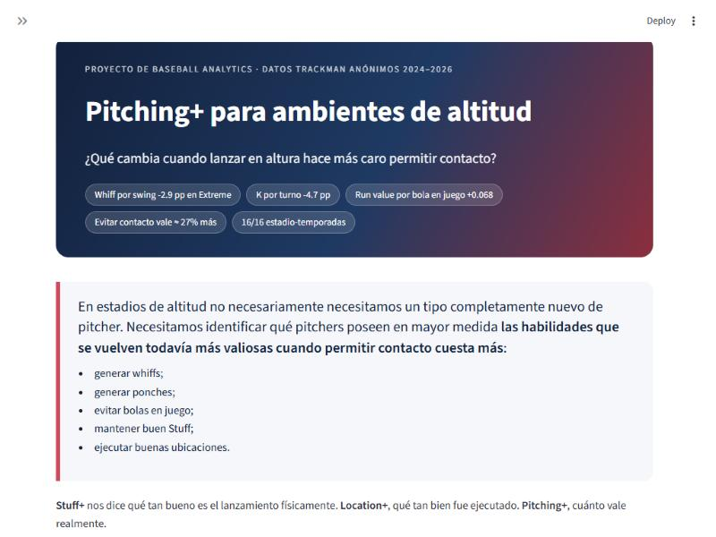

**El contacto cuesta más: pirámide y rodado**

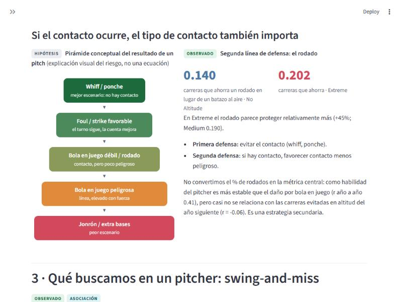

**Qué buscamos: estabilidad de cada métrica**

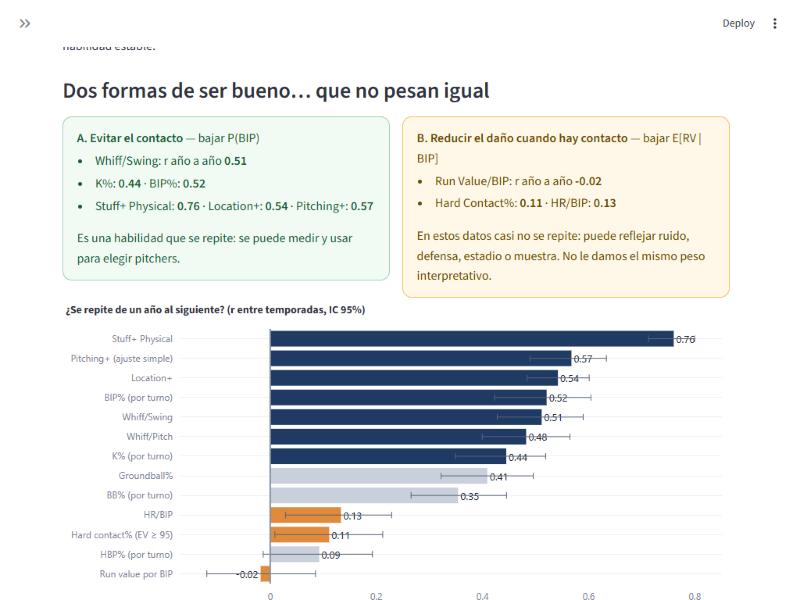

**Location+: regiones de la zona**

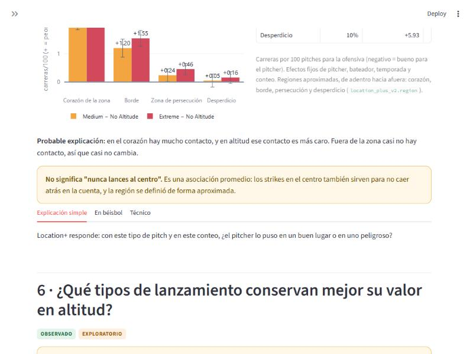

**Tipos de lanzamiento en altitud**

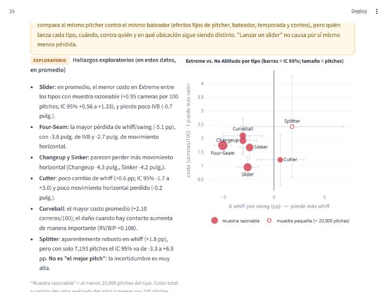

**Pitching+: árbol de probabilidades**

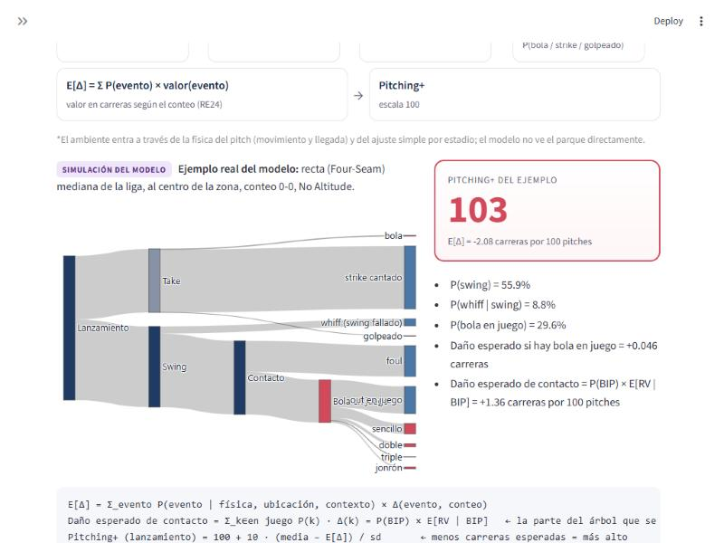

**Simulador: Construye tu lanzamiento**

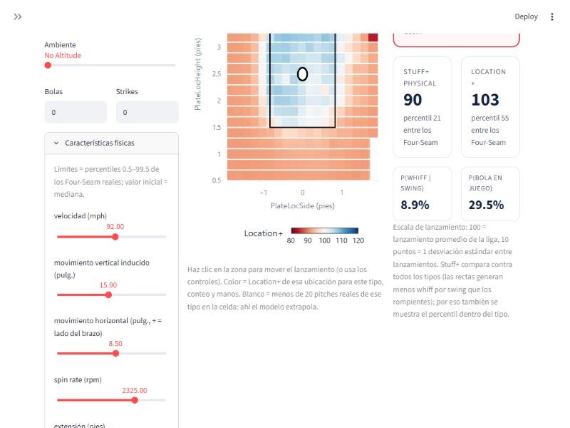

**Simulador: desglose P(BIP) × E[RV | BIP]**

![Simulador: desglose P(BIP) × E[RV | BIP]](reports/capturas_web/08_simulador_d_por_que.jpg)

**Ranking AEPP con incertidumbre**

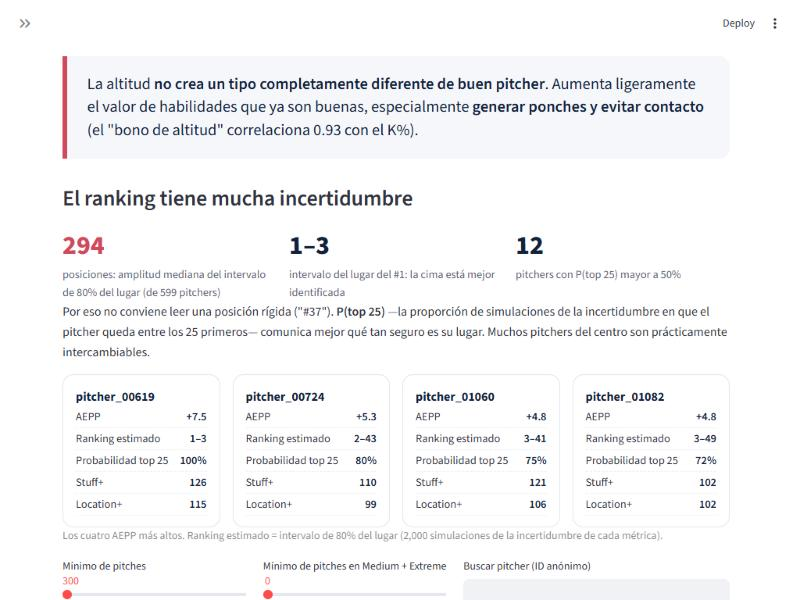

**Ficha del pitcher**

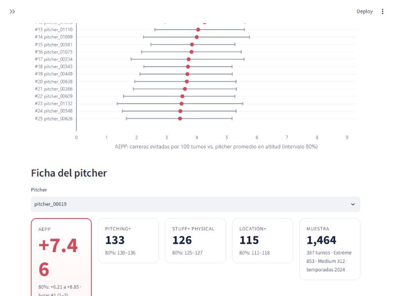

**Sensibilidad (exploratoria)**

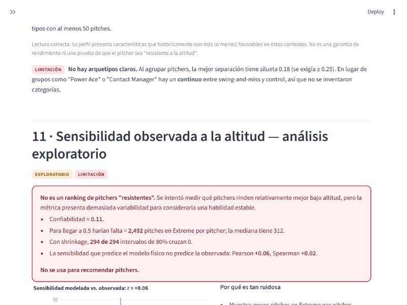

**Física y contrafactual**

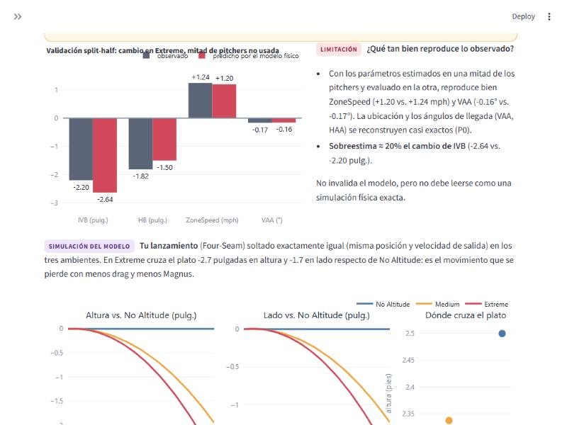

## Alcance del proyecto

1. **Ingesta y limpieza de datos** de trackeo de lanzamientos (velocidad, spin rate,
   movimiento horizontal/vertical, extensión, release point, resultado del pitch) de la LMB.
2. **Feature engineering** de métricas físicas del lanzamiento, normalizadas por tipo de
   pitch, brazo del lanzador y condiciones del parque (incluyendo altitud).
3. **Modelado predictivo** (gradient boosting: LightGBM/XGBoost) del valor esperado de cada
   lanzamiento en función de sus características físicas.
4. **Modelado bayesiano/causal** (PyMC, econml) para estimar y descontar el efecto causal
   de la altitud sobre las métricas observadas, evitando confundir "buen stuff" con
   "efecto de altitud".
5. **Validación** del modelo (calibración, backtesting, estabilidad año con año / entre
   parques) antes de publicar el índice.
6. **Reportes y dashboard interactivo** (Streamlit) para explorar el índice Stuff+ por
   lanzador, pitch y parque, incluyendo la corrección por altitud.

## Estructura del proyecto

```
.
├── data/
│   ├── raw/            # Datos crudos de tracking (sin modificar)
│   ├── processed/       # Datos limpios/transformados listos para modelado
│   └── web/             # Tablas y resúmenes que usa la página (generados por el pipeline)
├── notebooks/            # Exploración, prototipado y análisis ad-hoc
├── src/
│   ├── features/         # Ingeniería de características
│   ├── models/           # Entrenamiento e inferencia de modelos (Stuff+, altitud)
│   └── validation/        # Validación, calibración y métricas de evaluación
├── reports/               # Reportes generados (figuras, tablas, resúmenes)
├── web/                   # Página final (Streamlit): narrativa, simulador, ranking
├── dashboard/             # Dashboard anterior (legado; índice neutral físico)
├── tests/                 # Pruebas unitarias (pytest)
├── pyproject.toml
├── requirements.txt
└── README.md
```

## Entorno

Este proyecto usa Python ≥3.10. Dependencias principales:

- **Datos**: `pandas`, `polars`, `pyarrow`
- **Modelado**: `lightgbm`, `xgboost`, `scikit-learn`
- **Interpretabilidad**: `shap`
- **Modelado bayesiano/causal**: `pymc`, `arviz`, `econml`
- **Visualización / dashboard**: `streamlit`, `plotly`, `matplotlib`, `seaborn`
- **Testing**: `pytest`

### Instalación

Con `pip` y `pyproject.toml`:

```bash
pip install -e ".[dev]"
```

O bien con `requirements.txt`:

```bash
pip install -r requirements.txt
```

## Estado actual

**Página final:** `web/app.py` (P0–P2 integrados). Cuenta la historia completa:
1. evidencia de que el juego cambia en altitud;
2. el contacto cuesta más (y el rodado como segunda línea de defensa);
3. perfil favorable (swing-and-miss) y estabilidad de cada métrica;
4. Stuff+ Physical y Location+ (el corazón de la zona es la región que más valor pierde);
5. qué tipos de lanzamiento conservan mejor su valor (descriptivo, no causal);
6. **Pitching+**;
7. simulador "Construye tu lanzamiento" (P(BIP) × E[RV | BIP], contexto histórico del tipo y de la región) y comparación de ambientes;
8. ranking de pitchers (AEPP) con P(top 25) e intervalos de lugar;
9. sensibilidad exploratoria, física, limitaciones y qué mejoraríamos con más datos.

Arquitectura: `reports/web_architecture_plan.md`. Validación: `reports/web_final_validation.md`.

- **Pitching+** (índice principal): cadena de probabilidades condicionales valuada en carreras, con ajuste simple por
  temporada × estadio anónimo. El contrafactual físico se conserva como herramienta explicativa: no mostró ventaja
  predictiva frente al ajuste simple (`reports/p0_altitude_pipeline.md`).
- **Stuff+ Physical** y **Location+ v2**: `reports/stuff_plus_physical.md`, `reports/location_plus_v2.md`.
- **Perfiles y ranking (AEPP)**: `reports/p2_pitcher_profiles_altitude.md`.
- Bitácora completa: [`reports/resultados_finales.md`](reports/resultados_finales.md) (sección 7).

Entorno: `.venv` con Python 3.14, versiones exactas en `requirements-lock.txt`.

```bash
.venv\Scripts\python -m src.pipeline              # todo el pipeline, desde los datos crudos (incluye data/web/)
.venv\Scripts\python -m src.pipeline --from web_data   # solo regenerar los datos de la página
.venv\Scripts\python -m pytest tests             # pruebas (incluye tests/test_web.py)
.venv\Scripts\streamlit run web/app.py           # página final (http://localhost:8501)
```

La página no entrena modelos: usa los artefactos finales de `src/models/artifacts/` (`pitching_plus_v3.pkl`,
`stuff_plus_physical.pkl`, `location_plus_v2.pkl`) y los archivos de `data/web/`. Todas las cifras de los textos salen
de `data/web/summary.json`.
