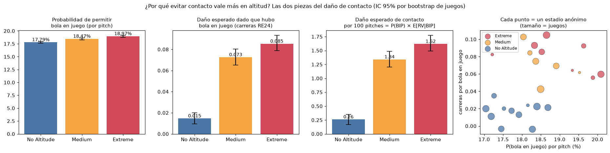
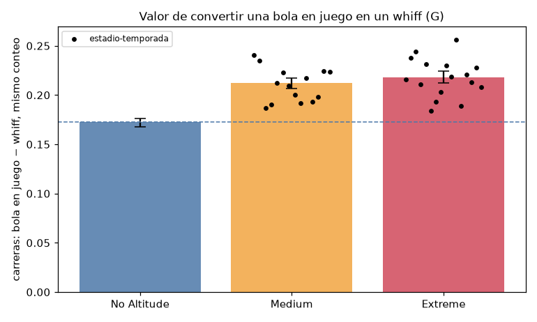
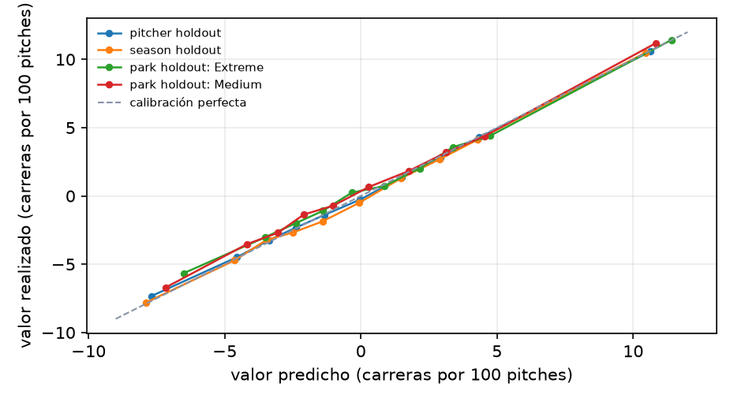

# Pitching+ para ambientes de altitud — Documento técnico

*Hackathon de analítica deportiva · datos Trackman anónimos 2024–2026 · proyecto reproducible (`python -m src.pipeline`)*

## 1. Resumen ejecutivo

El reto pregunta cómo medir la calidad de pitcheo cuando se lanza en altitud extrema (las condiciones de la Ciudad de México) y qué pitchers y lanzamientos convienen en ese ambiente. El dataset está anonimizado: para cada juego solo indica si fue en No Altitude, Medium o Extreme Altitude. Respondemos con la categoría **Extreme Altitude**, sin identificar qué estadio anónimo es cuál.

- **El juego cambia en altitud.** Comparando al mismo pitcher contra el mismo bateador, en Extreme el whiff por swing baja −2.9 pp, el ponche por turno −4.7 pp y cada bola en juego vale +0.068 carreras más, en 16 de 16 combinaciones estadio anónimo × temporada.
- **El contacto cuesta más y evitarlo vale más:** cambiar una bola en juego por un ponche vale ≈ 27% más en Extreme. 93% del aumento del daño de contacto viene del costo de cada bola en juego, no de que haya más.
- **Tres métricas separadas y un valor total:** Stuff+ Physical (física del pitch), Location+ (ubicación) y **Pitching+** (valor esperado del lanzamiento en carreras con un árbol de probabilidades).
- **Generaliza fuera de muestra:** supera al modelo nulo por conteo en pitcher, season y park holdout (mejora del MSE de 4.1% a 4.8%) y está calibrado (pendiente 0.96–1.00).
- **Perfil favorable:** swing-and-miss (whiffs, ponches, pocas bolas en juego). El ranking AEPP usa pesos en carreras de los ambientes de altitud y correlaciona 0.986 con el ranking con pesos de nivel del mar: la altitud no crea otro tipo de buen pitcher, premia más lo que ya era bueno.
- **Un gran lanzamiento sigue siendo un gran lanzamiento:** con los costos de Extreme el lanzamiento óptimo de cada tipo cambia menos que el ruido de muestreo en 21 de 21 combinaciones tipo × conteo.

## 2. Marco teórico

**Sabermetría.** El valor de un evento se mide en carreras con la matriz de carreras esperadas por estado de outs y corredores (RE24): el *run value* de una jugada es RE después − RE antes + carreras anotadas (Tango, Lichtman y Dolphin, 2007). Los índices "plus" (Stuff+, Location+, Pitching+) expresan la calidad del pitcheo en una escala con media 100 y 10 puntos por desviación estándar; separan las características físicas del pitch, su ubicación y su valor total, que se estabilizan con muchos menos lanzamientos que los resultados (FanGraphs, 2022).

**Física del béisbol.** Un lanzamiento está sometido a gravedad, arrastre (*drag*) y la fuerza de Magnus producida por el giro; ambas fuerzas aerodinámicas son proporcionales a la densidad del aire (Adair, 2002; Nathan, 2008). A mayor altitud, el aire es menos denso: la pelota frena menos y el giro la mueve menos, así que los pitches se mueven menos y la pelota bateada vuela más. El Trackman ajusta una trayectoria de aceleración constante (9 parámetros) de la que salen el movimiento vertical inducido (IVB) y el horizontal (HB).

**Entorno.** Con los propios datos estimamos la fuerza del aire en cada estadio anónimo: en Extreme el drag es 0.83–0.90 y el Magnus 0.72–0.84 veces el de No Altitude (I² = 98%: los estadios de Extreme no son iguales entre sí). Los estadios se reconstruyen sin información externa (98.4% de los juegos asignados; 19/19 grupos conservan su categoría entre temporadas).

## 3. Datos

627,185 lanzamientos Trackman de 2,116 juegos (2024, 2025 y 2026 parcial), con velocidad, spin, eje, salida, extensión, movimiento, ubicación, conteo, resultado del pitch y de la jugada, y la categoría de altitud de cada juego. Se corrigió el valor del golpeado (run value +0.397) y se reconstruyó el estado de corredores por turno para RE24. Ninguna fuente externa.

## 4. Decisiones de modelado

**Arquitectura: un árbol de probabilidades valuado en carreras.** Pitching+ encadena cinco clasificadores LightGBM (Ke et al., 2017), cada uno entrenado en su universo: P(swing); el resultado si no hay swing (bola, strike cantado, golpeado); P(whiff | swing); P(foul | contacto); y el resultado de la bola en juego (out, sencillo, doble, triple, jonrón). Las diez probabilidades suman 1 y el valor esperado es

> E[Δ] = Σ_evento P(evento | física, ubicación, conteo) × Δ(evento, conteo),

donde Δ es el cambio de carreras esperadas del turno: V(siguiente conteo) − V(conteo), o el valor terminal si el evento termina el turno. V(conteo) se obtiene hacia atrás desde los valores terminales con las frecuencias observadas de cada transición (el foul con dos strikes es un auto-lazo).

**¿Por qué no regresar directamente el run value?** Porque el run value de un pitch individual es casi todo ruido: un modelo de regresión directo con solo física quedó peor que el promedio por conteo. El árbol aprovecha que cada paso (swing, whiff, contacto) sí es predecible y valúa cada resultado con su costo en carreras. Tampoco sumamos Stuff+ y Location+: el valor de un buen movimiento depende de dónde termina el pitch y del conteo, y esa interacción la calcula el árbol.

**Función de pérdida.** Log-loss (entropía cruzada) binaria o multiclase en cada sub-modelo; hiperparámetros ajustados por sub-modelo con validación agrupada por pitcher. La log-loss premia probabilidades bien calibradas, que es lo que necesita un valor esperado.

**Features.**

- **Física:** velocidad, spin rate, eje de giro, altura y lado de salida, extensión, IVB, HB, pérdida de velocidad y ángulos de llegada *residualizados contra la ubicación* (para que no codifiquen dónde terminó el pitch).
- **Arsenal (relacionales):** diferencia de velocidad, IVB y HB contra la recta del mismo pitcher, y el tipo de pitch.
- **Contexto:** ubicación (lado y altura, espejadas para zurdos), conteo y si pitcher y bateador son del mismo lado.
- **Stuff+ Physical** usa solo física y arsenal (la ubicación explica 1.9% de su predicción, contra 46% de la versión de referencia v1). **Location+** usa solo ubicación, conteo, tipo y manos (correlación con Stuff+ −0.04).

**Ambiente.** Los modelos no reciben la altitud como variable. El ambiente se trata con un ajuste simple: a cada valor se le resta su promedio por temporada × estadio anónimo. Probamos también un contrafactual físico (re-simular cada trayectoria con el drag y el Magnus de otro ambiente); en la validación temporal estricta el ajuste simple predijo igual o mejor (sección 7), así que el contrafactual quedó como herramienta explicativa.

## 5. Definición formal de las escalas

Sea θ̂ᵢ el promedio de un pitcher (P(whiff | swing) para Stuff+, valor de ubicación para Location+, E[Δ] para Pitching+), ajustado por ambiente. El *shrinkage* empírico-bayesiano normal–normal (Efron y Morris, 1975) lo encoge hacia la media de la liga:

> θ̃ᵢ = μ + Bᵢ(θ̂ᵢ − μ), con Bᵢ = τ² / (τ² + σ²/nᵢ),

donde τ² es la varianza de la habilidad real entre pitchers y σ² la varianza por lanzamiento. La escala es

> Índice+ = 100 + 10 · s · (θ̃ᵢ − μ) / τ,

con s = +1 si más es mejor (Stuff+) y s = −1 si menos carreras es mejor (Location+ y Pitching+). Así, 100 es el pitcher promedio y 10 puntos una desviación estándar de **habilidad real**, no de ruido. Para un **lanzamiento individual** (simulador) se usa la escala de lanzamiento: 100 + 10·s·(v − media)/sd sobre todos los lanzamientos reales.

**AEPP** (perfil para ambientes de altitud): carreras evitadas por 100 turnos frente a un pitcher promedio, con los valores en carreras medidos en Medium + Extreme y tasas con *shrinkage*:

> AEPP = −100 · [Σ_{o ∈ K, BB, HBP} (rₒ − r̄ₒ)(vₒ − v_BIP) + r_BIP · (RV/BIPᵢ − RV/BIP̄)].

## 6. El efecto de la altitud

| métrica (Extreme vs. No Altitude, efectos fijos de pitcher, bateador, temporada y conteo) | No Altitude | Medium | Extreme [IC 95%] |
|---|---:|---:|---:|
| whiff por swing | 24.9% | −1.3 pp | −2.9 pp [−3.4, −2.4] |
| ponche por turno | 20.3% | −2.9 pp | −4.7 pp [−5.2, −4.1] |
| bola en juego por swing | 37.8% | +2.5 pp | +4.0 pp [+3.4, +4.5] |
| run value por bola en juego | 0.015 | +0.058 | +0.068 [+0.058, +0.078] |

Medium se parece a Extreme (run value por bola en juego +0.058 vs. +0.068): hablamos de ambientes de altitud, no de un umbral. Altitud y estadio están confundidos (pocos estadios por categoría): son asociaciones consistentes, no un efecto causal aislado de la altitud.

**Por tipo y por forma de pitch.** Comparando al mismo pitcher consigo mismo:

- la recta pierde −3.8 pulg. de IVB y −5.1 pp de whiff/swing;
- el slider es el tipo con menor costo promedio en Extreme (+0.95 carreras/100 pitches);
- sinker y changeup pierden más movimiento horizontal (−4.2 y −4.3 pulg.).

Dentro de cada tipo, los pitches que más dependen del giro pierden más:

| tipo · forma (movimiento a nivel del mar) | Δ Stuff+ | Δ whiff/swing | Δ contacto duro | Δ HR/BIP |
|---|---:|---:|---:|---:|
| Four-Seam · bajo ride | −3.8 | −1.4 pp | +1.4 pp | +0.7 pp |
| Four-Seam · alto ride | −7.7 | −7.9 pp | +4.2 pp | −0.6 pp |
| Sinker · bajo corrida al brazo | −1.1 | −2.2 pp | +6.1 pp | +1.7 pp |
| Sinker · alto corrida al brazo | −2.6 | −1.7 pp | +3.3 pp | +0.0 pp |
| Slider · bajo barrido | +0.1 | −2.2 pp | +3.2 pp | −0.3 pp |
| Slider · alto barrido | −1.1 | −4.7 pp | −1.4 pp | −0.1 pp |
| Curveball · bajo caída | −0.9 | −0.4 pp | +4.1 pp | −1.1 pp |
| Curveball · alto caída | −4.0 | −7.3 pp | −3.9 pp | −0.2 pp |
| Changeup · bajo fade | −0.5 | −0.5 pp | +1.6 pp | +0.8 pp |
| Changeup · alto fade | −1.3 | −4.0 pp | +7.5 pp | +2.0 pp |

Explicación física: con menos Magnus, el pitch que depende del giro para "subir", barrer o caer pierde más pulgadas, y con ellas parte del swing-and-miss; lo que se pierde en whiff se paga en contacto, que en altitud es más caro. Contacto duro = velocidad de salida ≥ 95 mph, sensible a la calibración del Trackman (el hard contact% promedio pasa de 21.5% en 2024 a 26.2% en 2025).

**Arsenal.** El Stuff+ calculado solo con pitches de Extreme es más alto en arsenales de recta + slider (Four-Seam + Cutter + Slider: 105.5; Four-Seam + Slider: 104.3) y correlaciona 0.91 con el Stuff+ general del pitcher: el arsenal que rinde en Extreme es el que rinde en general.

## 7. Validación fuera de muestra

**Nivel lanzamiento (modelo final, misma especificación e hiperparámetros).** Objetivo: el valor realizado del pitch, Δ(evento, conteo). Modelo nulo: el promedio del valor por conteo ("xRunValue promedio por conteo"), estimado en entrenamiento. El dataset no identifica estadios: el *park holdout* deja fuera **todos** los estadios de una categoría.

| esquema | pitches de prueba | RMSE modelo | RMSE nulo | mejora del MSE | pendiente de calibración | AUC Stuff+ (nulo por tipo) |
|---|---:|---:|---:|---:|---:|---:|
| pitcher holdout (k=5) | 627,185 | 0.2350 | 0.2407 | +4.65% | 0.98 | 0.651 (0.601) |
| season holdout (→ 2026) | 129,594 | 0.2339 | 0.2398 | +4.83% | 1.00 | 0.650 (0.603) |
| park holdout: Extreme | 180,794 | 0.2420 | 0.2471 | +4.10% | 0.96 | 0.650 (0.609) |
| park holdout: Medium | 154,048 | 0.2395 | 0.2449 | +4.33% | 0.98 | 0.650 (0.606) |

El valor de un pitch individual es muy ruidoso, por eso el RMSE baja poco en absoluto; lo importante es que el modelo supera al nulo y queda calibrado en pitchers, temporada y ambientes que no vio. Sin haber visto Extreme, subestima un poco su valor realizado (+0.0084 vs. +0.0106 carreras por pitch), lo que confirma que el contacto ahí cuesta más y justifica el ajuste por ambiente.

**Nivel pitcher (temporada t → t+1).** Estabilidad año a año: Stuff+ Physical 0.76, Pitching+ 0.57, Location+ 0.54, whiff/swing 0.51, run value por bola en juego −0.02. En la validación temporal estricta (entrenando solo con temporadas anteriores, 2025 → 2026), el ajuste simple por temporada × estadio anónimo (M1b) predice las carreras del año siguiente con r = 0.191 (mín. 100 pitches; 0.302 con mín. 300), por encima del contrafactual físico (0.148) y sin ajuste (0.158). AEPP predice las carreras en altitud del año siguiente con r = 0.26, mejor que Pitching+ (0.15; P = 98%) e igual que K−BB% con *shrinkage* (0.25); lo reportamos tal cual.

## 8. Uso para el cuerpo técnico

- **Simulador:** el pitching coach ingresa velocidad, IVB, HB, spin, extensión, salida, ubicación y conteo y obtiene Stuff+, Location+, Pitching+, P(whiff), P(bola en juego), el daño esperado de contacto y alertas si la combinación sale de lo observado. El mismo pitch se compara lado a lado en altitud y a nivel del mar, por física (re-simulación de la trayectoria) y por costo de los resultados (correlación de rangos general vs. Extreme 0.997; con dos strikes gana el swing-and-miss: correlación +0.70).
- **Ranking AEPP** con intervalo del lugar y P(top 25); la incertidumbre es grande (amplitud mediana del intervalo de 80%: 294 posiciones).
- **Recomendaciones:** formas de pitch que pierden más en altitud, mapa de movimiento de los pitches más y menos efectivos, arsenales y un flujo para perfilar prospectos con una calculadora de AEPP.
- **Lanzamiento óptimo por ambiente:** buscado entre lanzamientos reales (sin extrapolar); con la física aproximada del aire de Extreme el perfil óptimo sigue dentro del ruido en 17 de 21 combinaciones.

## 9. Alcance y fronteras del modelo

- **No causal:** altitud y estadio están confundidos; Medium se parece a Extreme.
- **Sensibilidad individual a la altitud no medible hoy:** confiabilidad 0.11; harían falta ≈ 2,492 pitches en Extreme por pitcher para 0.5; 294 de 294 intervalos cruzan 0. Hablamos de perfil favorable, no de resistencia demostrada.
- **Contrafactual físico aproximado:** sobreestima ≈ 20% el cambio de IVB (validación split-half); el modelo no ve el vuelo de la pelota bateada.
- **Validación temporal limitada:** dos pares de temporadas (2024 → 2025, 2025 → 2026); 2026 es parcial.
- **Calidad de rivales:** los efectos del ambiente la controlan; las métricas por pitcher del ranking no del todo.
- **Datos de contacto:** la velocidad de salida depende de la calibración de cada estadio y temporada; el daño por bola en juego de un pitcher casi no se repite (r = −0.02).
- **Outs no registrados:** `OutsOnPlay` casi no registra las dobles matanzas. En 1.7% de los turnos de No Altitude y 2.3% de los de Extreme (en rodados, 3.4% y 4.8%) el siguiente turno empieza con un out más de los registrados, así que el RE24 valora esos outs como si no hubieran ocurrido. El sesgo aproximado en el run value por bola en juego es +0.006 en No Altitude y +0.009 en Extreme: explicaría ≈ +0.002 de las +0.068 carreras de diferencia, dentro de su intervalo de confianza. No lo corregimos porque el dataset no trae corredores en base para saber qué out faltó.
- **El óptimo no es una receta:** no considera biomecánica, salud, secuencias, repertorio ni fatiga.

## Referencias

- Adair, R. K. (2002). *The Physics of Baseball* (3.ª ed.). HarperCollins.
- Efron, B., y Morris, C. (1975). Data analysis using Stein's estimator and its generalizations. *Journal of the American Statistical Association*, 70(350), 311–319.
- FanGraphs (2022). Stuff+, Location+ y Pitching+ (glosario y metodología).
- Ke, G. et al. (2017). LightGBM: A highly efficient gradient boosting decision tree. *Advances in Neural Information Processing Systems* 30.
- Nathan, A. M. (2008). The effect of spin on the flight of a baseball. *American Journal of Physics*, 76(2), 119–124.
- Tango, T. M., Lichtman, M., y Dolphin, A. (2007). *The Book: Playing the Percentages in Baseball*. Potomac Books.

*Reportes de respaldo: `reports/validacion_fuera_de_muestra.md`, `reports/p0_altitude_pipeline.md`, `reports/p2_pitcher_profiles_altitude.md`, `reports/pitching_plus_general_vs_altitude.md`, `reports/optimal_pitch_by_environment.md`, `reports/auditoria_matematica.md`.*
