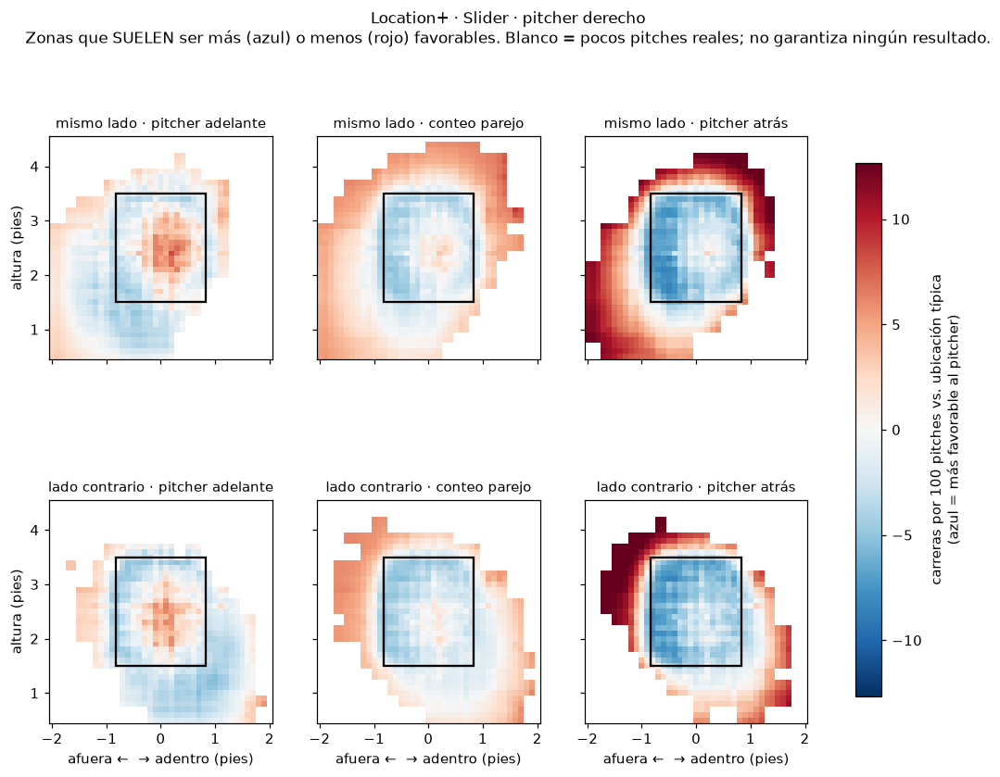
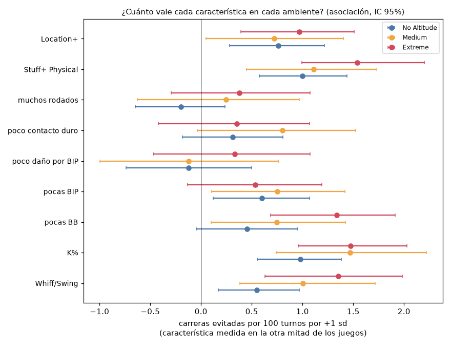
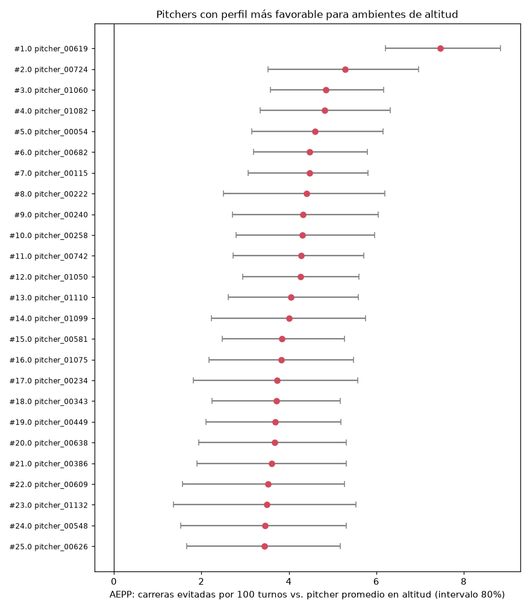
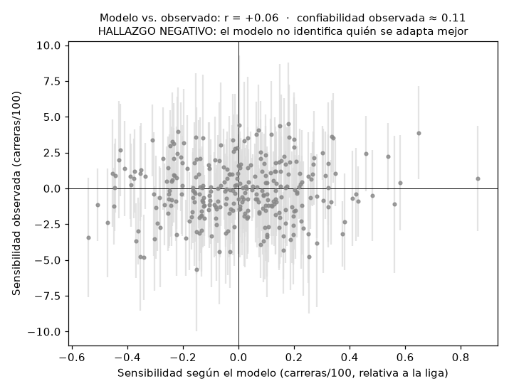

# P2 — Perfiles de pitcher para ambientes de altitud

Generado por `src/reports/p2_report.py` con los resultados de `src/analysis/pitcher_profiles.py`, `src/models/stuff_plus_physical.py` y `src/models/location_plus_v2.py` (pasos `stuff_physical`, `location_v2`, `profiles` y `p2_report` del pipeline). Usa solo el dataset del hackathon; estadios y pitchers con identificadores anónimos (`ANON_STADIUM_xx`, `pitcher_xxxxx`).

# 1. Resumen ejecutivo

**Los contextos de altitud media y extrema presentan patrones consistentes de menor capacidad de generar whiffs y ponches, junto con un mayor costo esperado cuando la pelota se pone en juego.** Es evidencia contextual fuerte, pero no identificación causal pura del efecto de la altitud.

- **El juego cambia (sección 2).** En Extreme, con el mismo pitcher contra el mismo bateador: whiff por swing -2.9 pp, ponches por turno -4.7 pp, run value por bola en juego +0.068 carreras; convertir una bola en juego en un whiff vale ≈ 27% más. Los cuatro efectos van en la misma dirección en **16/16** estadio-temporadas de Extreme. Medium se comporta de manera muy parecida.
- **Por qué evitar contacto vale más (sección 7).** El daño esperado de contacto sube de 0.26 a 1.62 carreras por 100 pitches. 93% del aumento viene de que cada bola en juego hace más daño; solo 1% de que haya más bolas en juego.
- **Perfil favorable (secciones 9–10).** Lo que más vale en altitud es **poncharse bateadores y evitar bolas en juego**: cambiar una bola en juego por un ponche vale 27% más en Extreme. El puntaje AEPP (pesos medidos en los datos, no elegidos a mano) predice las carreras del año siguiente en juegos de altitud mejor que Pitching+ (r = 0.26 vs. 0.15, P = 98%), pero **igual que un simple K−BB% con shrinkage**.
- **Resultado importante:** el perfil favorable para altitud es casi el mismo que el perfil bueno en cualquier parte (correlación de rangos con pesos de altitud vs. de No Altitude = 0.986). La altitud agrega un **bono pequeño** a los pitchers que ponchan mucho (correlación bono–K% = 0.93); no produce una lista distinta de pitchers.
- **Stuff+ Physical y Location+ (secciones 4–6)** son métricas separadas y casi independientes (r = -0.04). La ubicación explica 1.9% de la varianza de Stuff+ Physical, contra 45.6% en Stuff+ v1, y Stuff+ Physical predice el whiff/swing del año siguiente mejor que v4.
- **Resultados negativos que se conservan:**
  - el contrafactual físico no supera al ajuste simple;
  - la sensibilidad individual observada tiene confiabilidad ≈ 0.11;
  - la sensibilidad modelada no predice la observada (r = 0.06);
  - los arquetipos de pitcher no forman grupos claros (silueta máxima 0.18).

Orden de prioridad de esta etapa: 1) evidencia de que el juego cambia, 2) perfil favorable, 3) Stuff+ Physical, 4) Location+, 5) ranking de perfiles, 6) sensibilidad individual (secundaria), 7) contrafactual (explicativo).

---

# 2. Evidencia de que el juego cambia en contextos de altitud

> **En una frase:** los contextos de altitud media y extrema presentan patrones consistentes de menor capacidad de generar whiffs y ponches, junto con un mayor costo esperado cuando la pelota se pone en juego. Es evidencia contextual fuerte, **no** identificación causal pura del efecto de la altitud.

## 2.1 Qué cambia y cuánto

Diferencias respecto de No Altitude con **efectos fijos de pitcher y bateador** (además de temporada y conteo): comparan al mismo pitcher contra el mismo bateador. IC 95% con errores agrupados por juego (`reports/hipotesis_altitud.md`).

| variable | No Altitude (promedio) | Medium − No | Extreme − No [IC 95%] | cambio relativo en Extreme | diferencia cruda E − N |
|---|---:|---:|---|---:|---:|
| **Whiff/Swing** | 24.9% | -1.3 pp | **-2.9 pp** [-3.4, -2.4] | -12% | -1.7 pp |
| **K/PA** | 20.3% | -2.9 pp | **-4.7 pp** [-5.2, -4.1] | -23% | -3.6 pp |
| **Bola en juego por swing** | 37.8% | +2.5 pp | **+4.0 pp** [+3.4, +4.5] | 10% | +2.9 pp |
| **Run value por BIP (carreras)** | +0.015 | +0.058 | **+0.068** [+0.058, +0.078] | de +0.015 a +0.082 | +0.071 |
| **Valor de evitar contacto (G)** | 0.172 carreras | +0.040 | **+0.046** [+0.038, +0.053] | **27% más** | — |

G mide cuántas carreras más le cuesta al pitcher una bola en juego que un whiff en el mismo conteo. En Extreme, convertir una bola en juego en un whiff ahorra 0.218 carreras, contra 0.172 en No Altitude: **≈ 27% más**. Medido por turno (sección 7.3), cambiar una bola en juego por un ponche vale 27% más: el resultado es prácticamente el mismo.

Tasas crudas por ambiente (sin controles, para dar escala):

| ambiente | pitches | turnos | whiff/swing | K/PA | BB/PA | BIP/PA | run value por BIP |
|---|---:|---:|---:|---:|---:|---:|---:|
| No Altitude | 292,343 | 75,262 | 24.9% | 20.2% | 9.3% | 69.1% | +0.015 |
| Medium | 154,048 | 40,017 | 24.1% | 17.8% | 9.6% | 71.1% | +0.073 |
| Extreme | 180,794 | 47,610 | 23.2% | 16.7% | 9.9% | 72.0% | +0.085 |

## 2.2 Consistencia por estadio-temporada

Cada estadio anónimo de cada temporada se compara por separado contra No Altitude, con los mismos efectos fijos. Si el efecto viniera de un solo estadio o de una sola temporada, muchas combinaciones tendrían el signo contrario.

| variable | Extreme: combinaciones en la dirección | Medium: combinaciones en la dirección |
|---|---:|---:|
| Whiff/Swing | **16/16** | 11/14 |
| K/PA | **16/16** | 14/14 |
| Bola en juego por swing | **16/16** | 14/14 |
| Run value por BIP (carreras) | **16/16** | 14/14 |
| G mayor que en No Altitude | **16/16** | 14/14 |

Nota sobre el conteo: la bitácora previa reportaba 13/13 estadio-temporadas con la reconstrucción de estadios anterior a P0. Con los grupos anónimos estables de P0 hay 16 combinaciones estadio-temporada de Extreme, y el patrón se mantiene en todas. El hallazgo no cambia; cambió la unidad de conteo.

## 2.3 Medium se parece mucho a Extreme

- Run value por bola en juego: Medium +0.058 vs. Extreme +0.068 carreras.
- Valor de evitar contacto: Medium +0.040 vs. Extreme +0.046 carreras.
- Ponches por turno: Medium -2.9 pp vs. Extreme -4.7 pp.
- La diferencia más clara está en el whiff por swing: Medium -1.3 pp vs. Extreme -2.9 pp. En Medium, además, el efecto no aparece en todos los estadios (11/14).

Como Medium muestra casi el mismo aumento en el daño del contacto, **no podemos afirmar que la altitud extrema cause directamente todos estos efectos**: una parte puede venir de otras características que comparten esos estadios.

## 2.4 Lo que NO podemos atribuir causalmente a la altitud

- Cada categoría agrupa pocos estadios anónimos (5–6 por temporada en Extreme). La altitud no se puede separar de las dimensiones del parque, el clima, la superficie o la calibración del Trackman de cada estadio.
- Los controles por pitcher y bateador quitan el efecto de quién juega, pero no el de las otras cosas que tienen en común los estadios de altitud.
- El efecto es el promedio de esos estadios; cada uno tiene su propia magnitud (`reports/estadios_anonimos.md`).
- Lo que sí es sólido: el patrón (menos whiffs y ponches, contacto más caro) es grande, aparece en todos los estadio-temporada de Extreme y no depende de quién lanzó o bateó.

---

# 3. Stuff+ v1 — benchmark predictivo

- Modelo de P(whiff) sobre **todos** los pitches: AUC 0.7315 en su universo; sobre swings, AUC 0.686.
- Es el mejor en AUC pitch a pitch porque **ve la ubicación de forma implícita** (ángulos de salida y de llegada) y la categoría de altitud: la ubicación explica 45.6% de la varianza de sus predicciones dentro de cada tipo de pitch.
- Se conserva **solo como benchmark predictivo**. No es la definición conceptual de Stuff+ (calidad física del pitch).

# 4. Stuff+ Physical

Detalle completo, con la auditoría variable por variable: `reports/stuff_plus_physical.md`.

**Objetivo:** medir la calidad de las características físicas del lanzamiento sin dar crédito directo a la ubicación final ni al ambiente.

## 4.1 Auditoría de features

| Variable | Física | Contiene ubicación | Contiene altitud | Posible leakage | Usar |
|---|---:|---:|---:|---:|---:|
| RelSpeed | sí | no | mínima (se mide en la salida) | no | sí |
| EffectiveVelo | sí | no | mínima | no | no |
| ZoneSpeed | sí | no | sí (drag) | altitud | no |
| SpeedDrop | parcial | no | sí, casi toda (drag) | altitud | no |
| ZoneTime | parcial | no | sí (drag) | altitud | no |
| SpinRate | sí | no | mínima (se mide en la salida) | no | sí |
| SpinAxis | sí | no | no | no | sí |
| Tilt | sí | no | no | no | no |
| HorzBreak | sí | no | sí (Magnus) | altitud parcial | sí |
| InducedVertBreak | sí | no | sí (Magnus) | altitud parcial | sí |
| VertBreak | sí | no | sí | altitud | no |
| pfxx / pfxz | sí | no | sí | altitud | no |
| RelHeight | sí | no | no | no | sí |
| RelSide | sí | no | no | no | sí |
| Extension | sí | no | no | no | sí |
| VertRelAngle / HorzRelAngle | parcial | sí (a dónde apunta) | no | ubicación | no |
| VertApprAngle / HorzApprAngle | parcial | sí (fuerte) | parcial | ubicación | no (crudos) |
| vaa_loc_adj / haa_loc_adj | sí | residualizada | parcial | baja | sí |
| x0…az0 (9 parámetros) | sí | vx0, vz0 sí | ax, az sí | ubicación y altitud | no |
| magnus_residual_vert / _horz | derivada | no | sí (supone elevaciones) | altitud | no |
| altitude_level / altitude_category | no | no | sí | ambiente | no |
| PlateLocHeight / PlateLocSide | no | sí | no | ubicación | no |
| Balls / Strikes / count | no | no | no | contexto | no |
| velo_diff_vs_fb / ivb_diff_vs_fb / hb_diff_vs_fb | sí (arsenal) | no | parcial (se cancela en parte) | baja | sí |
| tunnel_similarity | derivada | sí (usa VAA/HAA crudos) | parcial | ubicación | no |
| pitch_usage_pct / prev_pitch_type | no | no | no | uso y secuencia | no |
| AutoPitchType | sí (clasificación) | no | no | no | sí |
| same_side (mano bateador vs pitcher) | no | no | no | contexto del enfrentamiento | solo para entrenar |

## 4.2 Target

Se usa **P(whiff | swing)**: la capacidad de hacer fallar al bateador **una vez que decide hacer swing**. No mide la capacidad de inducir el swing, que depende sobre todo de la ubicación y del conteo (Location+). Candidatos descartados:

- whiff por pitch: mezcla Stuff con Location; es el target de v1;
- evitar contacto: es el mismo target;
- valor esperado sin ubicación: sin ubicación, el swing y el take son casi ruido, y el componente de contacto no predice el año siguiente.

## 4.3 ¿Stuff observado o neutralizado?

El movimiento (IVB, HB) cambia con la densidad del aire.

- Es parte real de lo que el bateador ve ("stuff observado").
- Pero si se comparan pitchers que lanzaron en ambientes distintos, castiga a quien lanzó en altitud; por eso hace falta un "stuff neutralizado".

No se eliminó el movimiento. Se calcularon tres versiones con el mismo modelo:

| versión | qué hace con el ambiente | r con % de pitches en Extreme | estabilidad (mín. 100) | whiff/swing t+1 |
|---|---|---:|---:|---:|
| Observado | nada (lo que el bateador vio) | -0.163 | 0.745 | 0.323 |
| **Oficial** | ajuste simple temporada × estadio anónimo | -0.015 | 0.760 | 0.340 |
| Neutral | contrafactual físico a No Altitude | -0.006 | 0.780 | 0.308 |

- La versión observada castiga al pitcher por lanzar en altitud (r = -0.16 con su % de pitches en Extreme). Las otras dos lo neutralizan.
- La oficial (ajuste simple) predice el whiff/swing del año siguiente mejor que la neutral.
- Las dos correlacionan 0.957, por debajo del umbral de 0.98 fijado antes, así que se conservan ambas: la **oficial para rankear** y la neutral solo para explicar el mecanismo físico.

---

# 5. Location+

Detalle: `reports/location_plus_v2.md`. **Pregunta:** dado el tipo de pitch y el contexto (conteo, manos), ¿qué tan favorable es la ubicación donde terminó el pitch?

- Usa el mismo árbol de probabilidades de Pitching+ (swing, take, whiff, foul, resultado en juego), valuado en carreras.
- Sus variables son **solo** la ubicación (lado relativo al bateador y altura), el conteo, el tipo de pitch y las manos. No usa velocidad ni movimiento.
- El puntaje por pitch es el valor esperado en esa ubicación menos el promedio del mismo contexto (tipo × conteo × manos): solo cuenta dónde terminó el pitch, no qué pitch era ni en qué conteo.
- Estabilidad año a año 0.54.
- Predice el BB% del año siguiente (r = -0.39) **mejor que el propio BB%** (r = +0.35).

Valor por región de la zona en cada ambiente, con efectos fijos de pitcher, bateador, temporada y conteo. Carreras por 100 pitches; positivo = malo para el pitcher.

| región | Δ en No Altitude | Medium − No | Extreme − No |
|---|---:|---:|---:|
| corazón | -3.21 | +2.38 ± 0.52 | +2.92 ± 0.49 |
| borde | -2.82 | +1.20 ± 0.32 | +1.55 ± 0.28 |
| persecución | +2.74 | +0.24 ± 0.22 | +0.46 ± 0.20 |
| desperdicio | +5.93 | +0.05 ± 0.23 | +0.16 ± 0.21 |

Lectura: en altitud **los pitches en el corazón de la zona son los que más valor pierden**, porque ahí hay más contacto y el contacto es más caro; los pitches fuera de la zona casi no cambian. Es una asociación, no una regla de ubicación.

Hay mapas de calor por tipo de pitch, mano del bateador y grupo de conteo en `reports/figures/p2/location_*.png`. Muestran zonas que **suelen** ser más favorables para cada tipo de pitch; ninguna zona garantiza un out.

---

# 6. Comparación de métricas

## 6.1 Stuff+

| métrica | AUC whiff \| swing | ubicación en la predicción | estabilidad (mín. 100) | whiff/swing t+1 | carreras t+1 | separación conceptual |
|---|---:|---:|---:|---:|---:|---|
| Stuff+ v1 benchmark | 0.686 | 45.6% | 0.668 | 0.332 | 0.168 | mezcla física, ubicación y altitud |
| Stuff+ v4 | 0.651 | 2.2% | 0.769 | 0.304 | 0.142 | física; neutral por contrafactual; incluye SpeedDrop y lado del bateador |
| **Stuff+ Physical** | 0.645 | 1.9% | 0.760 | 0.340 | 0.173 | física; ajuste simple por estadio; lado del bateador marginalizado |

**Decisión:** Stuff+ Physical es el Stuff+ conceptual del proyecto. No se eligió por AUC: pierde AUC frente a v1, porque ya no ve la ubicación. Lo que cuenta es que es más estable, predice el whiff/swing del año siguiente igual que v1 y mejor que v4 (Δr = +0.036, P = 98%), es interpretable (solo física) y es útil para scouting: dice cuánto swing-and-miss genera el pitch por sí mismo.

## 6.2 Todas las métricas por pitcher: estabilidad y relación con carreras en altitud del año siguiente

Pitcher-temporadas con ≥ 100 pitches. *Estabilidad* = correlación año a año del valor ajustado (sin shrinkage). La última columna es la correlación con las carreras evitadas por 100 turnos en juegos de Medium y Extreme del año siguiente (≥ 40 turnos). El signo esperado depende de si la métrica es "mayor = mejor".

| métrica | mayor es mejor | estabilidad [IC 95%] | r con carreras en altitud t+1 [IC 95%] | lectura |
|---|:---:|---|---|---|
| Whiff/Swing | sí | 0.51 [0.43, 0.59] | +0.20 [+0.09, +0.30] | estable y predictiva |
| Whiff/Pitch | sí | 0.48 [0.40, 0.56] | +0.19 [+0.09, +0.30] | estable y predictiva |
| K% (por turno) | sí | 0.44 [0.35, 0.52] | +0.24 [+0.12, +0.34] | estable y predictiva |
| BB% (por turno) | no | 0.35 [0.27, 0.45] | -0.09 [-0.22, +0.06] | estable, relación débil con carreras |
| HBP% (por turno) | no | 0.09 [-0.01, 0.19] | -0.12 [-0.25, +0.01] | poco estable (casi ruido de muestra) |
| BIP% (por turno) | no | 0.52 [0.42, 0.60] | -0.13 [-0.27, +0.01] | estable, relación débil con carreras |
| Run value por BIP | no | -0.02 [-0.12, 0.09] | -0.04 [-0.14, +0.07] | poco estable (casi ruido de muestra) |
| Hard contact% (EV ≥ 95) | no | 0.11 [0.01, 0.21] | -0.07 [-0.18, +0.04] | poco estable (casi ruido de muestra) |
| Groundball% | sí | 0.41 [0.32, 0.50] | -0.06 [-0.21, +0.10] | estable, relación débil con carreras |
| HR/BIP | no | 0.13 [0.03, 0.23] | +0.09 [-0.03, +0.22] | poco estable (casi ruido de muestra) |
| Stuff+ Physical | sí | 0.76 [0.71, 0.80] | +0.11 [-0.00, +0.23] | estable, relación débil con carreras |
| Location+ | sí | 0.54 [0.48, 0.60] | +0.14 [+0.01, +0.26] | estable y predictiva |
| Pitching+ (ajuste simple) | sí | 0.57 [0.49, 0.63] | +0.15 [+0.03, +0.25] | estable y predictiva |

Lo importante para el perfil:

- **Whiff/swing, K% y BIP% son estables.**
- El daño por bola en juego (run value por BIP, hard contact%, HR/BIP) **casi no se repite de un año a otro**: en estos datos, limitar el daño una vez que hay contacto es sobre todo ruido y contexto, no una habilidad estable del pitcher.
- Por eso, en el perfil esa parte entra muy encogida hacia el promedio.

## 6.3 Pitching+: índice principal simple

En P0 el ajuste simple por entorno predijo igual o mejor que el contrafactual físico. Por eso **el Pitching+ de P2 es el de ajuste simple por temporada × estadio anónimo (M1b)**. El Pitching+ neutral físico se conserva como explicación física, herramienta contrafactual y análisis de mecanismos: *Este modelo es explicativo y contrafactual; no mostró una ventaja predictiva frente a una normalización ambiental más simple.*

---

# 7. Valor de evitar contacto

## 7.1 Formalización

    Daño esperado de contacto por pitch = P(BIP) × E[RunValue | BIP]

En el árbol de probabilidades de Pitching+:

    P(BIP) = P(swing) · (1 − P(whiff | swing)) · (1 − P(foul | contacto))
    E[Δ | BIP] = Σ_k P(k | BIP) · Δ(k, conteo),   k ∈ {out, 1B, 2B, 3B, HR}
    componente de bola en juego de E[Δ] = Σ_k P(k) · Δ(k) = P(BIP) · E[Δ | BIP]

Verificación numérica sobre las predicciones OOF de Pitching+: la identidad se cumple con error máximo 5.6e-17, y el producto del árbol reproduce P(BIP) con error máximo 4.4e-16. **Evitar contacto** (bajar P(BIP)) y **contacto menos peligroso** (bajar E[Δ | BIP]) son las dos ramas del mismo término.

## 7.2 Cómo cambia cada componente entre ambientes

| ambiente | P(BIP) por pitch [IC 95%] | E[RV \| BIP] en carreras [IC 95%] | daño por 100 pitches [IC 95%] | P(BIP) por turno |
|---|---|---|---|---:|
| No Altitude | 17.79% [17.65%, 17.93%] | +0.015 [+0.009, +0.020] | +0.26 [+0.17, +0.35] | 69.1% |
| Medium | 18.47% [18.28%, 18.65%] | +0.073 [+0.065, +0.080] | +1.34 [+1.20, +1.49] | 71.1% |
| Extreme | 18.97% [18.78%, 19.15%] | +0.085 [+0.079, +0.093] | +1.62 [+1.49, +1.77] | 72.0% |

Descomposición del aumento del daño frente a No Altitude (carreras por 100 pitches):

| ambiente | total [IC 95%] | por más bolas en juego | por más daño por bola en juego | interacción |
|---|---|---:|---:|---:|
| Medium | +1.08 [+0.90, +1.25] | +0.01 | +1.03 | +0.04 |
| Extreme | +1.36 [+1.20, +1.53] | +0.02 | +1.26 | +0.08 |

**Lectura:** en altitud casi no cambia *cuántas* bolas en juego hay por pitch; cambia *cuánto cuesta cada una*. Por eso evitar el contacto vale más aunque el pitcher no permita más contacto que antes.

Calibración del árbol por ambiente (el modelo de Pitching+ no recibe el ambiente como variable):

| ambiente | P(BIP) predicho | observado | E[Δ \| BIP] predicho | observado |
|---|---:|---:|---:|---:|
| No Altitude | 17.80% | 17.79% | +0.020 | +0.017 |
| Medium | 18.60% | 18.47% | +0.044 | +0.065 |
| Extreme | 18.79% | 18.97% | +0.056 | +0.072 |

El árbol acierta la probabilidad de contacto en todos los ambientes, pero **subestima el daño por bola en juego en altitud**. La física del pitch explica solo una parte del aumento; el resto viene del ambiente (vuelo de la pelota, parque). Es otra razón para medir el ambiente con el ajuste simple por estadio.

## 7.3 Pesos lineales por ambiente (valor RE24 de cada resultado del turno)

| ambiente | ponche | base por bolas | golpeado | bola en juego | ponche − bola en juego [IC 95%] | BB − bola en juego | aire − rodado | duro − no duro |
|---|---:|---:|---:|---:|---|---:|---:|---:|
| No Altitude | -0.326 | +0.378 | +0.389 | +0.015 | -0.340 [-0.347, -0.334] | +0.363 | +0.140 | +0.430 |
| Medium | -0.339 | +0.372 | +0.413 | +0.073 | -0.412 [-0.422, -0.403] | +0.299 | +0.190 | +0.433 |
| Extreme | -0.347 | +0.384 | +0.395 | +0.085 | -0.432 [-0.442, -0.423] | +0.299 | +0.202 | +0.453 |
| Altitud (Medium + Extreme) | -0.343 | +0.379 | +0.404 | +0.080 | -0.423 [-0.430, -0.417] | +0.299 | +0.197 | +0.444 |

- **Ponche en lugar de bola en juego:** vale 0.340 carreras en No Altitude y 0.432 en Extreme (**27% más**). Es la misma conclusión que G (≈ 27%), medida por turno en vez de por swing.
- **Base por bolas en lugar de bola en juego:** cuesta 0.363 en No Altitude y 0.299 en Extreme. En altitud la base por bolas es relativamente *menos* grave, porque la alternativa (la bola en juego) es más cara.
- **Rodado en lugar de batazo al aire:** ahorra 0.140 carreras en No Altitude y 0.202 en Extreme: en altitud el rodado protege más.
- **Contacto duro:** la diferencia duro − no duro pasa de 0.430 a 0.453.

---

# 8. Pitch mix

Efecto de Extreme por tipo de pitch frente a No Altitude:

- los resultados, con efectos fijos de pitcher, bateador, temporada y conteo;
- el movimiento y la velocidad, comparando dentro del mismo pitcher × tipo × temporada.

**Es el promedio de cada tipo de pitch, no el efecto causal de elegir ese pitch**: quién lanza cada tipo, y cuándo, también cambia.

| tipo | pitches | whiff/swing en No Altitude | Δ whiff/swing | Δ BIP/swing | Δ run value por BIP | Δ IVB (pulg.) | Δ HB absoluto (pulg.) | costo en Extreme (carreras/100 pitches) | costo en Medium |
|---|---:|---:|---:|---:|---:|---:|---:|---:|---:|
| Four-Seam | 214,789 | 21.6% | -5.1 ± 0.8 pp | +6.4 pp | +0.070 ± 0.018 | -3.8 (de 17.1) | -2.7 (de 9.5) | +1.74 ± 0.29 | +1.48 |
| Sinker | 109,244 | 15.3% | -2.4 ± 1.0 pp | +3.9 pp | +0.072 ± 0.021 | -2.2 (de 10.3) | -4.2 (de 15.6) | +1.67 ± 0.41 | +1.58 |
| Cutter | 26,070 | 22.2% | +0.6 ± 2.4 pp | +0.1 pp | +0.074 ± 0.055 | -2.3 (de 10.8) | -0.2 (de 2.8) | +1.22 ± 0.91 | +0.67 |
| Slider | 137,234 | 32.7% | -2.6 ± 1.1 pp | +2.9 pp | +0.045 ± 0.022 | -0.7 (de 4.2) | -1.4 (de 5.7) | +0.95 ± 0.38 | +0.84 |
| Curveball | 53,212 | 33.1% | -3.1 ± 1.9 pp | +5.0 pp | +0.108 ± 0.043 | +1.6 (de 8.6) | -2.9 (de 9.5) | +2.10 ± 0.62 | +0.40 |
| Changeup | 77,611 | 29.3% | -3.1 ± 1.4 pp | +3.3 pp | +0.072 ± 0.029 | -2.0 (de 7.7) | -4.3 (de 13.5) | +1.92 ± 0.52 | +1.17 |
| Splitter | 7,193 | 32.2% | +1.8 ± 5.1 pp | +2.7 pp | +0.174 ± 0.103 | -0.7 (de 7.1) | -3.0 (de 7.4) | +2.43 ± 1.84 | +1.46 |

- **El que más whiff pierde:** Four-Seam (-5.1 pp), con la mayor pérdida de movimiento vertical inducido (-3.8 pulgadas).
- **Los que más movimiento horizontal pierden:** sinker y changeup (≈ −4 pulgadas).
- **El de menor costo total en Extreme:** Slider (+0.95 carreras por 100 pitches).
- **Los que casi no pierden whiff:** cutter y splitter; el splitter tiene poca muestra.
- **Los que más daño permiten cuando hay contacto:** splitter y curveball, con intervalos amplios.

**¿Hay una mezcla más robusta?** Para cada pitcher se calculó el costo esperado de su mezcla (Σ participación × costo del tipo):

- se relaciona con la sensibilidad que predice el modelo (r = +0.45);
- **no** se relaciona con la sensibilidad observada (r = +0.05, 294 pitchers).

Una mezcla cargada a sliders y cutters pierde menos *en promedio*, pero los datos no muestran que esos pitchers rindan relativamente mejor en altitud.

---

# 9. Perfil favorable para ambientes de altitud

**Pregunta:** ¿qué características parecen especialmente valiosas cuando el contexto penaliza más el contacto? Se respondió con tres piezas, sin asumir la respuesta:

1. **Contabilidad de carreras por ambiente** (pesos lineales, sección 7.3): cuánto vale cada resultado del turno en cada ambiente.
2. **Estabilidad y poder predictivo** de cada característica (sección 6.2): cuáles son habilidad del pitcher y cuáles ruido.
3. **Interacción con el ambiente** (abajo): si ser mejor en una característica previene relativamente más carreras en altitud.

## 9.1 ¿Vale más cada característica en altitud? (asociación)

Diseño cruzado: la característica del pitcher se mide en una mitad de sus juegos y las carreras de sus turnos en la otra mitad, para que el mismo ruido no aparezca en ambos lados.

- Pendiente = carreras evitadas por 100 turnos por cada desviación estándar de mejora.
- IC 95% por bootstrap de pitchers.

| característica (+1 sd = mejor) | No Altitude | Medium | Extreme | Extreme − No [IC 95%] | P(mayor en Extreme) |
|---|---:|---:|---:|---|---:|
| Whiff/Swing | +0.55 | +1.00 | +1.35 | +0.80 [+0.08, +1.49] | 99% |
| K% | +0.98 | +1.47 | +1.47 | +0.50 [-0.14, +1.23] | 95% |
| pocas BB | +0.45 | +0.75 | +1.34 | +0.88 [+0.11, +1.66] | 98% |
| pocas BIP | +0.60 | +0.75 | +0.53 | -0.07 [-0.88, +0.77] | 41% |
| poco daño por BIP | -0.12 | -0.12 | +0.33 | +0.45 [-0.34, +1.28] | 86% |
| poco contacto duro | +0.31 | +0.80 | +0.35 | +0.04 [-0.79, +0.82] | 55% |
| muchos rodados | -0.20 | +0.24 | +0.38 | +0.57 [-0.21, +1.39] | 91% |
| Stuff+ Physical | +1.00 | +1.11 | +1.54 | +0.54 [-0.09, +1.27] | 96% |
| Location+ | +0.76 | +0.72 | +0.97 | +0.21 [-0.50, +0.95] | 77% |

- Diferencias Extreme − No con IC que excluye 0: **Whiff/Swing, pocas BB**.
- Generar whiffs y ponches, y el Stuff+ Physical que los produce, tiende a valer más en Extreme (P ≥ 95%), como predice la contabilidad de carreras.
- Son 9 características × 2 ambientes: con tantas comparaciones, algún intervalo puede excluir 0 por azar. Se leen como un **patrón exploratorio coherente**, no como pruebas individuales.
- Dar pocas bases por bolas también aparece con más valor en Extreme, al revés de lo que indican los pesos lineales (allí una BB es relativamente menos grave). Lo más probable es que los pitchers con control también sean mejores en otras cosas, así que no se interpreta como un efecto propio del control.
- El daño por bola en juego, el contacto duro y el porcentaje de rodados no muestran con claridad un valor marginal distinto.

## 9.2 El perfil ideal, según los datos

| característica | ¿más valiosa en altitud? | ¿es habilidad estable? | conclusión |
|---|---|---|---|
| Whiff/Swing, K% | sí: un ponche en vez de una BIP vale 27% más; pendiente mayor en Extreme | sí (≈ 0.45–0.51) | **núcleo del perfil** |
| Pocas bolas en juego (BIP%) | sí (es la otra cara del ponche) | sí (≈ 0.52) | **núcleo del perfil** |
| Stuff+ Physical | sí (pendiente mayor en Extreme) | sí (≈ 0.76) | **fuente física del whiff**; entra a través del whiff y el K% |
| Location+ / pocas BB | ambiguo (los pesos dicen que la BB pesa relativamente menos) | sí (≈ 0.54 / 0.35) | importante, pero no especialmente más en altitud |
| Poco daño por BIP / poco contacto duro | el daño pesa más en altitud | **no** (≈ 0 / 0.11) | valioso, pero no medible como habilidad: entra muy encogido |
| Rodados (GB%) | el rodado protege más (aire − rodado: 0.14 → 0.20) | sí (≈ 0.41) | ayuda poco a predecir carreras; secundario |

## 9.3 Puntaje compuesto sin pesos arbitrarios: AEPP

Las carreras de un turno se descomponen **exactamente** por su resultado:

    R = Σ_o r_o · v_o,   o ∈ {K, BB, HBP, BIP},   Σ_o r_o = 1
    R_i − R̄ = Σ_{o≠BIP} (r_o,i − r̄_o)·(v_o − v_BIP) + r_BIP,i · d_i
    AEPP_i = −100 · (R_i − R̄)   [carreras evitadas por 100 turnos frente a un pitcher promedio]

- r_o,i: tasas del pitcher por turno (K%, BB%, HBP%; BIP% = 1 − las otras), ajustadas por entorno y con shrinkage.
- d_i: su daño por bola en juego relativo a la liga, con shrinkage. Casi todo se encoge al promedio, porque no es estable.
- v_o: **pesos lineales de los ambientes de altitud (Medium + Extreme)** medidos en los datos (sección 7.3).

Ningún peso se eligió a mano: el peso de cada característica es lo que vale en carreras en ese ambiente. También se exploraron PCA y clustering (sección 11): describen cómo se agrupan las características, pero no dan pesos con significado en carreras. Como comparación simple se usa K−BB% con shrinkage (sección 9.4). No se ajustó una regresión para elegir pesos: con dos pares de temporadas habría riesgo de sobreajuste, y la contabilidad de carreras ya da pesos con justificación.

Antes de calcularlo se fijó una regla para usar Stuff+ Physical y Location+ como covariables (media a priori del shrinkage de K%, BB% y daño por BIP): se adoptan solo si mejoran la predicción del mismo componente en t+1 con P ≥ 0.80.

| componente | Δr t+1 con covariables [IC 95%] | P | ¿se adopta? |
|---|---|---:|---|
| k_pct | +0.011 [-0.023, +0.045] | 75% | no |
| bb_pct | +0.022 [-0.044, +0.090] | 72% | no |
| rv_bip | +0.001 [-0.106, +0.103] | 52% | no |

Ninguna mejora lo suficiente, así que el perfil usa shrinkage simple. Stuff+ Physical y Location+ aparecen en la ficha del pitcher pero no cambian su puntaje: su información ya está en el whiff, el K% y el BB% observados.

## 9.4 Validación del perfil

Se predicen, con la pitcher-temporada t, las carreras evitadas por 100 turnos en t+1 (ajustadas por entorno): en juegos de altitud (≥ 40 turnos de altitud en t+1) y en todos los juegos.

**Mínimo 100 pitches** (437 pares; 279 con suficientes turnos de altitud)

| puntaje | estabilidad | carreras t+1 (todos) | carreras t+1 en altitud | Δ vs Pitching+ en altitud (P) |
|---|---|---|---|---|
| AEPP (pesos de altitud) | +0.422 [+0.341, +0.496] | +0.266 [+0.188, +0.336] | +0.261 [+0.157, +0.355] | +0.114 (98%) |
| mismo perfil con pesos de No Altitude | +0.401 [+0.318, +0.473] | +0.267 [+0.186, +0.338] | +0.258 [+0.152, +0.352] | +0.111 (98%) |
| Pitching+ (ajuste simple por estadio) | +0.567 [+0.499, +0.631] | +0.189 [+0.109, +0.270] | +0.147 [+0.029, +0.245] | referencia |
| Stuff+ Physical | +0.760 [+0.715, +0.800] | +0.169 [+0.081, +0.259] | +0.113 [-0.009, +0.228] | -0.033 (33%) |
| Location+ | +0.542 [+0.479, +0.600] | +0.139 [+0.045, +0.230] | +0.141 [+0.008, +0.257] | -0.006 (50%) |
| K−BB% (con shrinkage) | +0.404 [+0.324, +0.486] | +0.271 [+0.188, +0.344] | +0.252 [+0.137, +0.346] | +0.106 (97%) |
| carreras evitadas del año (crudo ajustado) | +0.122 [+0.038, +0.202] | +0.122 [+0.038, +0.202] | +0.132 [+0.023, +0.231] | -0.014 (44%) |

AEPP con pesos de altitud vs. el mismo perfil con pesos de No Altitude, prediciendo carreras en altitud: Δr = +0.003 [-0.017, +0.027], P = 63%.

**Mínimo 300 pitches** (245 pares; 195 con suficientes turnos de altitud)

| puntaje | estabilidad | carreras t+1 (todos) | carreras t+1 en altitud | Δ vs Pitching+ en altitud (P) |
|---|---|---|---|---|
| AEPP (pesos de altitud) | +0.468 [+0.359, +0.563] | +0.289 [+0.170, +0.397] | +0.252 [+0.130, +0.362] | +0.088 (90%) |
| mismo perfil con pesos de No Altitude | +0.444 [+0.331, +0.549] | +0.286 [+0.164, +0.394] | +0.240 [+0.119, +0.348] | +0.076 (87%) |
| Pitching+ (ajuste simple por estadio) | +0.603 [+0.512, +0.676] | +0.229 [+0.112, +0.353] | +0.164 [+0.032, +0.294] | referencia |
| Stuff+ Physical | +0.754 [+0.697, +0.808] | +0.104 [-0.027, +0.246] | +0.081 [-0.083, +0.242] | -0.084 (15%) |
| Location+ | +0.580 [+0.490, +0.648] | +0.152 [+0.026, +0.266] | +0.096 [-0.041, +0.237] | -0.068 (18%) |
| K−BB% (con shrinkage) | +0.443 [+0.331, +0.533] | +0.282 [+0.157, +0.391] | +0.226 [+0.097, +0.343] | +0.062 (80%) |
| carreras evitadas del año (crudo ajustado) | +0.230 [+0.109, +0.340] | +0.230 [+0.109, +0.340] | +0.221 [+0.084, +0.338] | +0.057 (74%) |

AEPP con pesos de altitud vs. el mismo perfil con pesos de No Altitude, prediciendo carreras en altitud: Δr = +0.012 [-0.014, +0.041], P = 80%.

**Lectura honesta:**

- El perfil por resultados (AEPP, o simplemente K−BB% con shrinkage) predice las carreras en altitud del año siguiente mejor que Pitching+ (r ≈ 0.26 vs. 0.15).
- AEPP **no** supera a K−BB%: aporta interpretabilidad (está en carreras y separa ponches, bases por bolas y daño), no más precisión.
- Usar los pesos de altitud en lugar de los de No Altitude **no** mejora la predicción de forma detectable. El perfil favorable para altitud y el perfil bueno en general ordenan casi igual a los pitchers.

## 9.5 K al nivel correcto (turno)

- **Unidad:** el turno, representado por su pitch terminal (ponche, base por bolas, golpeado o bola en juego). Cada ponche cuenta una vez; ningún resultado se copia a los pitches del turno (verificado en `tests/test_p2.py`).
- **Features:** para el efecto del ambiente, efectos fijos de pitcher, bateador y temporada (sección 2). Para el pitcher, su K% por turno ajustado por entorno, con shrinkage normal-normal (τ ≈ 0.04–0.045 por temporada).
- **Temporalidad:** la validación usa la temporada t para predecir t+1, sin información futura.
- **Pesos:** cada turno pesa 1; los promedios por pitcher se ponderan por sus turnos.
- **K% por ambiente (crudo):** No Altitude 20.2%, Medium 17.8%, Extreme 16.7%. Con controles, -4.7 pp en Extreme.

---

# 10. Ranking principal de pitchers

## Pitchers con perfil más favorable para ambientes de altitud

**Altitude Environment Pitcher Profile (AEPP).** Elegibles: ≥ 300 pitches y ≥ 75 turnos en 2024–2026 (599 pitchers). No usa la sensibilidad observada. Los intervalos de 80% del puntaje y del lugar salen de 2,000 extracciones de los posteriores de cada componente.

> Lectura correcta: *su perfil presenta características que históricamente son más favorables en estos contextos.* No significa que el pitcher vaya a rendir mejor en altitud con seguridad, ni que sea "resistente a la altitud".

| # | pitcher | AEPP [80%] | lugar [80%] | P(top 25) | pitches (Extreme / Medium) | K% | BB% | whiff/swing | Stuff+ Phys | Location+ | por qué aparece alto |
|---:|---|---|---|---:|---|---:|---:|---:|---:|---:|---|
| 1 | pitcher_00619 | +7.46 [+6.21, +8.85] | 1–3 | 100% | 1,464 (853 / 312) | 32.8% | 6.8% | 33.9% | 126 | 115 | genera muchos whiffs por swing; poncha a muchos bateadores; permite pocas bolas en juego; el contacto que permite hace poco daño; permite poco contacto duro; da pocas bases por bolas; Stuff físico fuerte; buen Location+. |
| 2 | pitcher_00724 | +5.29 [+3.52, +6.97] | 2–43 | 80% | 631 (68 / 70) | 31.6% | 10.2% | 39.1% | 110 | 99 | genera muchos whiffs por swing; poncha a muchos bateadores; permite pocas bolas en juego; Stuff físico fuerte. Puntos débiles: induce pocos rodados. |
| 3 | pitcher_01060 | +4.84 [+3.58, +6.16] | 3–41 | 75% | 1,519 (1,190 / 72) | 28.4% | 7.9% | 31.4% | 121 | 106 | genera muchos whiffs por swing; poncha a muchos bateadores; permite pocas bolas en juego; el contacto que permite hace poco daño; da pocas bases por bolas; Stuff físico fuerte; buen Location+. |
| 4 | pitcher_01082 | +4.81 [+3.34, +6.32] | 3–49 | 72% | 1,150 (314 / 546) | 29.4% | 8.9% | 30.4% | 102 | 102 | genera muchos whiffs por swing; poncha a muchos bateadores; permite pocas bolas en juego. Puntos débiles: el contacto que permite hace mucho daño. |
| 5 | pitcher_00054 | +4.59 [+3.15, +6.15] | 4–58 | 67% | 1,090 (73 / 164) | 28.4% | 8.7% | 30.5% | 110 | 103 | genera muchos whiffs por swing; poncha a muchos bateadores; permite pocas bolas en juego; Stuff físico fuerte. Puntos débiles: permite mucho contacto duro. |
| 6 | pitcher_00682 | +4.47 [+3.19, +5.80] | 5–56 | 64% | 1,701 (1,100 / 288) | 27.6% | 8.3% | 37.4% | 103 | 94 | genera muchos whiffs por swing; poncha a muchos bateadores; permite pocas bolas en juego; el contacto que permite hace poco daño; permite poco contacto duro; induce muchos rodados; da pocas bases por bolas. |
| 7 | pitcher_00115 | +4.47 [+3.07, +5.81] | 5–62 | 62% | 1,712 (159 / 1,218) | 27.0% | 8.5% | 27.8% | 107 | 104 | genera muchos whiffs por swing; poncha a muchos bateadores; permite pocas bolas en juego; el contacto que permite hace poco daño; permite poco contacto duro; Stuff físico fuerte. Puntos débiles: induce pocos rodados. |
| 8 | pitcher_00222 | +4.41 [+2.50, +6.20] | 3–90 | 58% | 528 (21 / 109) | 27.0% | 8.1% | 32.3% | 109 | 102 | genera muchos whiffs por swing; poncha a muchos bateadores; permite pocas bolas en juego; el contacto que permite hace poco daño; induce muchos rodados; da pocas bases por bolas; Stuff físico fuerte. |
| 9 | pitcher_00240 | +4.32 [+2.71, +6.05] | 4–80 | 58% | 717 (93 / 86) | 28.5% | 9.6% | 31.0% | 109 | 108 | genera muchos whiffs por swing; poncha a muchos bateadores; permite pocas bolas en juego; Stuff físico fuerte; buen Location+. Puntos débiles: permite mucho contacto duro. |
| 10 | pitcher_00258 | +4.32 [+2.79, +5.96] | 4–74 | 56% | 903 (582 / 14) | 28.5% | 9.8% | 31.3% | 105 | 100 | genera muchos whiffs por swing; poncha a muchos bateadores; permite pocas bolas en juego. |
| 11 | pitcher_00742 | +4.28 [+2.72, +5.71] | 5–78 | 54% | 1,201 (230 / 141) | 27.1% | 7.9% | 32.0% | 111 | 102 | genera muchos whiffs por swing; poncha a muchos bateadores; permite pocas bolas en juego; permite poco contacto duro; da pocas bases por bolas; Stuff físico fuerte. Puntos débiles: el contacto que permite hace mucho daño; induce pocos rodados. |
| 12 | pitcher_01050 | +4.26 [+2.94, +5.60] | 6–67 | 55% | 1,764 (191 / 304) | 27.3% | 8.2% | 31.2% | 104 | 101 | genera muchos whiffs por swing; poncha a muchos bateadores; permite pocas bolas en juego; el contacto que permite hace poco daño; da pocas bases por bolas. Puntos débiles: induce pocos rodados. |
| 13 | pitcher_01110 | +4.05 [+2.61, +5.59] | 6–85 | 48% | 1,218 (238 / 160) | 27.7% | 8.9% | 29.4% | 100 | 102 | genera muchos whiffs por swing; poncha a muchos bateadores; permite pocas bolas en juego. Puntos débiles: induce pocos rodados. |
| 14 | pitcher_01099 | +4.00 [+2.23, +5.76] | 5–109 | 47% | 634 (378 / 7) | 26.0% | 8.1% | 31.2% | 97 | 110 | genera muchos whiffs por swing; poncha a muchos bateadores; permite pocas bolas en juego; el contacto que permite hace poco daño; permite poco contacto duro; induce muchos rodados; da pocas bases por bolas; buen Location+. |
| 15 | pitcher_00581 | +3.85 [+2.48, +5.27] | 8–93 | 40% | 1,601 (514 / 717) | 26.0% | 8.0% | 30.1% | 99 | 109 | genera muchos whiffs por swing; poncha a muchos bateadores; permite pocas bolas en juego; permite poco contacto duro; da pocas bases por bolas; buen Location+. Puntos débiles: induce pocos rodados. |
| 16 | pitcher_01075 | +3.83 [+2.17, +5.48] | 7–114 | 40% | 761 (205 / 411) | 25.3% | 7.2% | 31.7% | 120 | 98 | genera muchos whiffs por swing; poncha a muchos bateadores; permite pocas bolas en juego; el contacto que permite hace poco daño; induce muchos rodados; da pocas bases por bolas; Stuff físico fuerte. |
| 17 | pitcher_00234 | +3.73 [+1.82, +5.58] | 6–140 | 39% | 430 (38 / 73) | 26.3% | 8.9% | 25.6% | 102 | 97 | poncha a muchos bateadores; permite pocas bolas en juego; el contacto que permite hace poco daño; permite poco contacto duro. |
| 18 | pitcher_00343 | +3.71 [+2.25, +5.18] | 9–108 | 36% | 1,225 (673 / 213) | 26.1% | 8.0% | 31.6% | 99 | 102 | genera muchos whiffs por swing; poncha a muchos bateadores; permite pocas bolas en juego; permite poco contacto duro; da pocas bases por bolas. Puntos débiles: el contacto que permite hace mucho daño. |
| 19 | pitcher_00449 | +3.69 [+2.11, +5.18] | 9–116 | 36% | 1,098 (209 / 343) | 27.5% | 10.1% | 33.2% | 116 | 98 | genera muchos whiffs por swing; poncha a muchos bateadores; permite pocas bolas en juego; permite poco contacto duro; Stuff físico fuerte. Puntos débiles: el contacto que permite hace mucho daño. |
| 20 | pitcher_00638 | +3.67 [+1.94, +5.31] | 8–129 | 36% | 698 (493 / 0) | 25.4% | 7.5% | 26.0% | 112 | 112 | poncha a muchos bateadores; permite pocas bolas en juego; da pocas bases por bolas; Stuff físico fuerte; buen Location+. |
| 21 | pitcher_00386 | +3.61 [+1.90, +5.32] | 8–133 | 34% | 732 (97 / 464) | 26.5% | 9.6% | 30.9% | 128 | 96 | genera muchos whiffs por swing; poncha a muchos bateadores; permite pocas bolas en juego; el contacto que permite hace poco daño; induce muchos rodados; Stuff físico fuerte. |
| 22 | pitcher_00609 | +3.52 [+1.57, +5.27] | 8–159 | 32% | 447 (145 / 37) | 25.7% | 8.6% | 30.0% | 114 | 104 | genera muchos whiffs por swing; poncha a muchos bateadores; permite pocas bolas en juego; Stuff físico fuerte. |
| 23 | pitcher_01132 | +3.50 [+1.36, +5.53] | 6–180 | 34% | 350 (96 / 47) | 23.6% | 5.8% | 22.4% | 108 | 106 | poncha a muchos bateadores; induce muchos rodados; da pocas bases por bolas; Stuff físico fuerte; buen Location+. |
| 24 | pitcher_00548 | +3.46 [+1.53, +5.31] | 8–166 | 32% | 542 (37 / 102) | 25.2% | 8.4% | 28.2% | 110 | 103 | genera muchos whiffs por swing; poncha a muchos bateadores; permite pocas bolas en juego; permite poco contacto duro; Stuff físico fuerte. |
| 25 | pitcher_00626 | +3.45 [+1.66, +5.17] | 9–152 | 30% | 641 (24 / 152) | 28.1% | 12.1% | 35.9% | 115 | 101 | genera muchos whiffs por swing; poncha a muchos bateadores; permite pocas bolas en juego; Stuff físico fuerte. Puntos débiles: da muchas bases por bolas. |

La tabla completa (599 pitchers, con ficha y explicación) está en `data/web/pitcher_rankings.csv` y `data/web/pitcher_altitude_profiles.csv`.

## 10.1 Ficha de pitcher

Cada fila de `pitcher_altitude_profiles.csv` contiene:

- **Muestra:** pitches, turnos y swings, y pitches por ambiente.
- **Índices:** Stuff+ Physical, Location+ y Pitching+, cada uno con intervalo de 80%.
- **Métricas de resultado:** whiff/swing, whiff/pitch, K%, BB%, HBP%, contact%, BIP%, run value/BIP, hard contact%, GB% y HR/BIP. Cada una en versión cruda, ajustada y con shrinkage, con su intervalo, su muestra y su factor de encogimiento.
- **Perfil:** mezcla de pitches; AEPP con intervalo y lugar; arquetipo; percentiles; y una explicación en texto.

## 10.2 ¿Quién gana más con los pesos de altitud? (bono de altitud)

Bono = AEPP con pesos de altitud − AEPP con pesos de No Altitude. Es pequeño (sd 0.33 carreras por 100 turnos, contra 1.66 del AEPP). Depende sobre todo del K% (r = 0.93) y en parte del BB% (r = +0.41): en altitud, ponchar vale más y la base por bolas pesa relativamente menos que una bola en juego, así que el ponchador con algo de descontrol pierde menos que en No Altitude.

| pitcher | lugar AEPP | bono [80%] | K% | BB% |
|---|---:|---|---:|---:|
| pitcher_00724 | 2 | +1.13 [+0.81, +1.44] | 31.6% | 10.2% |
| pitcher_00204 | 41 | +1.10 [+0.85, +1.37] | 28.6% | 14.0% |
| pitcher_00560 | 110 | +1.01 [+0.75, +1.27] | 26.3% | 15.7% |
| pitcher_00573 | 33 | +0.99 [+0.70, +1.30] | 28.2% | 12.9% |
| pitcher_00619 | 1 | +0.98 [+0.76, +1.20] | 32.8% | 6.8% |
| pitcher_00626 | 25 | +0.94 [+0.62, +1.22] | 28.1% | 12.1% |
| pitcher_00643 | 63 | +0.92 [+0.60, +1.21] | 26.8% | 12.9% |
| pitcher_00058 | 49 | +0.89 [+0.58, +1.19] | 26.9% | 12.7% |
| pitcher_01082 | 4 | +0.84 [+0.58, +1.08] | 29.4% | 8.9% |
| pitcher_00233 | 70 | +0.83 [+0.54, +1.13] | 26.0% | 12.8% |

---

# 11. Arquetipos de pitchers

k-means sobre whiff_swing, bb_pct, gb_pct, hard_pct, stuff_plus_physical, location_plus (estandarizados y orientados: + = mejor para el pitcher), con k = 2…7. Regla fijada antes: usar nombres de arquetipo solo si la silueta es ≥ 0.25 y la estabilidad (ARI en bootstrap) es ≥ 0.6.

| k | 2 | 3 | 4 | 5 | 6 | 7 |
|---|---:|---:|---:|---:|---:|---:|
| silueta | 0.178 | 0.177 | 0.159 | 0.150 | 0.153 | 0.147 |

El mejor k es 2, con silueta 0.178 y ARI de estabilidad 0.69. **Los datos no producen grupos claros, así que no se usan los nombres de arquetipo propuestos (Whiff dominant, Contact manager, etc.).**

| perfil | n | centroide (z orientado) | AEPP medio | bono de altitud medio |
|---|---:|---|---:|---:|
| Perfil 1 | 303 | whiff_swing +0.54, bb_pct -0.55, gb_pct -0.04, hard_pct +0.11, stuff_plus_physical +0.48, location_plus -0.57 | +0.61 | +0.21 |
| Perfil 2 | 296 | whiff_swing -0.56, bb_pct +0.57, gb_pct +0.04, hard_pct -0.11, stuff_plus_physical -0.49, location_plus +0.58 | +0.00 | -0.18 |

Componentes principales: PC1 explica 32% de la varianza y PC2 24%. Cargas de PC1: whiff_swing -0.46, bb_pct +0.55, gb_pct -0.00, hard_pct -0.13, stuff_plus_physical -0.42, location_plus +0.55.

**Lectura:** en lugar de grupos hay un **continuo** con un eje dominante: *swing-and-miss / Stuff* en un extremo y *control / ubicación* en el otro. Los pitchers del lado de swing-and-miss tienen en promedio un bono de altitud positivo, y los del lado de control uno negativo. Es coherente con la sección 7.3: en altitud el ponche vale más y la base por bolas pesa relativamente menos.

---

# 12. Sensibilidad modelada

*Este modelo es explicativo y contrafactual; no mostró una ventaja predictiva frente a una normalización ambiental más simple.*

- **Definición:** para cada pitch, el valor esperado proyectado a Extreme menos el proyectado a No Altitude (mismo pitch, contrafactual físico), promediado por pitcher. Todos los pitchers reciben los mismos ratios de densidad del aire por tipo de pitch.
- Dispersión entre pitchers: sd = 0.28 carreras por 100 pitches (relativa a la liga).
- La mezcla de tipos de pitch explica R² = 0.44 de la sensibilidad modelada (`reports/sensibilidad_altitud.md`). El costo de la mezcla de la sección 8 correlaciona r = +0.45 con ella.
- Es un **perfil de pitches** (qué tipo de pitches pierde más con menos densidad), no una medición de cómo reacciona el pitcher.
- Usos válidos: visualizar cambios físicos, simular ambientes, explicar qué variables cambian y separar mecanismos.

# 13. Sensibilidad observada

- **Definición:** S_emp = 100·[media_Extreme(Δ̃) − media_No(Δ̃)], con Δ̃ = valor realizado del pitch menos el promedio de su temporada y categoría. Positivo = le fue relativamente peor en Extreme.
- Pitchers con ≥ 150 pitches en Extreme y en No Altitude: 294.
- La sd observada (1.99) es casi igual al error estándar típico (1.88): la variación entre pitchers es del mismo tamaño que el ruido.
- **Confiabilidad (mitades de juegos, Spearman–Brown) = 0.11.**
- Entre temporadas (pitchers con ≥ 75 pitches en cada ambiente en dos temporadas): r = +0.15 [-0.02, +0.30], 137 pares.

## 13.1 ¿Por qué la confiabilidad es tan baja?

| posible causa | evidencia | lectura |
|---|---|---|
| tamaño de muestra | mediana 312 pitches en Extreme; para confiabilidad 0.5 harían falta ≈ 2,492, y para 0.7 ≈ 5,815 | **causa principal**: ningún pitcher tiene esa muestra |
| calidad de los rivales | r(rivales más fuertes en Extreme que en No, S_emp) = +0.24 | parte de la "sensibilidad" es a quién enfrentó |
| estadio | r(drag promedio de sus estadios de Extreme, S_emp) = -0.15 | algo de contexto: no todos los Extreme son iguales |
| cambio de pitch mix | r(cambio de mezcla entre Extreme y No, S_emp) = +0.10 | poco |
| abridor / relevista | abridores -0.08 (n=129), relevistas -0.21 (n=165) | sin diferencia relevante |
| equipo local en Extreme | -0.37 (n=118) vs. -0.02 (n=176) | pequeña, dentro del ruido |
| selección | quienes tienen S_emp: Pitching+ neutral medio 100.0 y 1,309 pitches, contra 97.1 y 323 | solo se mide a pitchers con mucho uso |
| regresión a la media | factor de shrinkage medio 0.87 | casi todo se encoge a 0 |

No se intentó "arreglar" la confiabilidad. **Sigue siendo baja y es una limitación del proyecto.**

# 14. Ranking exploratorio de sensibilidad

> ⚠️ **ADVERTENCIA METODOLÓGICA.** Este ranking se incluye porque fue una de las hipótesis exploradas durante el proyecto. Sin embargo, su confiabilidad estimada es únicamente 0.11, por lo que **NO debe interpretarse como evidencia de una capacidad estable del pitcher para resistir la altitud**. No se usa en el perfil ni en el ranking principal.

Ver el ranking exploratorio (los 10 con menor sensibilidad encogida)

| lugar | pitcher | S_emp cruda [80%] | S_emp con shrinkage [80%] | shrinkage | pitches Extreme / No | S_mod relativa | confiabilidad |
|---:|---|---|---|---:|---|---:|---:|
| 1 | pitcher_00106 | -3.94 [-5.76, -2.12] | -0.70 [-1.46, +0.07] | 0.82 | 785 / 680 | +0.08 | 0.11 |
| 2 | pitcher_00649 | -4.44 [-6.42, -2.46] | -0.68 [-1.46, +0.09] | 0.85 | 263 / 740 | -0.03 | 0.11 |
| 3 | pitcher_00778 | -2.45 [-3.94, -0.96] | -0.59 [-1.33, +0.14] | 0.76 | 649 / 1522 | -0.29 | 0.11 |
| 4 | pitcher_00595 | -3.18 [-4.95, -1.41] | -0.59 [-1.35, +0.17] | 0.82 | 361 / 641 | +0.37 | 0.11 |
| 5 | pitcher_00134 | -4.83 [-7.16, -2.49] | -0.56 [-1.35, +0.24] | 0.88 | 426 / 223 | -0.34 | 0.11 |
| 6 | pitcher_00361 | -3.66 [-5.70, -1.62] | -0.53 [-1.31, +0.25] | 0.85 | 764 / 306 | -0.37 | 0.11 |
| 7 | pitcher_00682 | -2.99 [-4.82, -1.16] | -0.52 [-1.29, +0.24] | 0.83 | 1100 / 313 | -0.36 | 0.11 |
| 8 | pitcher_00519 | -2.11 [-3.61, -0.60] | -0.50 [-1.24, +0.23] | 0.76 | 1015 / 764 | -0.12 | 0.11 |
| 9 | pitcher_00343 | -3.46 [-5.54, -1.38] | -0.49 [-1.27, +0.29] | 0.86 | 673 / 339 | -0.19 | 0.11 |
| 10 | pitcher_00340 | -4.30 [-6.69, -1.91] | -0.48 [-1.27, +0.32] | 0.89 | 156 / 1071 | +0.16 | 0.11 |

Con shrinkage, 294 de 294 intervalos de 80% cruzan 0. Los intervalos crudos que no cruzan 0 son en su mayoría los extremos esperados por azar entre 294 pitchers. La tabla completa, con la advertencia en cada fila, está en `data/web/pitcher_sensitivity.csv`.

# 15. Model vs observed sensitivity

**Hallazgo negativo importante:** corr(sensibilidad modelada, sensibilidad observada) = **+0.06** (Spearman +0.02; 294 pitchers).

Interpretación: **nuestro contrafactual físico no identifica actualmente qué pitchers muestran mejor adaptación observada a los ambientes de altitud.**

- Con una confiabilidad observada de 0.11, ni un modelo perfecto podría correlacionar más de ≈ 0.33 con la medida observada.
- El problema es doble: el contrafactual describe tipos de pitch, y la medida observada es casi toda ruido.

---

# 16. Incertidumbre

- **Ranking principal:** el intervalo de 80% del lugar tiene una amplitud mediana de 294 posiciones (de 599). La cima está bien separada (el #1 queda entre 1 y 3), pero el centro de la tabla es casi intercambiable. Por eso se publican P(top 25) y el intervalo, no solo el lugar.
- **Componentes:** con ~300 turnos, el K% de un pitcher tiene un error estándar de ≈ 2 pp. El daño por bola en juego casi no tiene señal (confiabilidad típica < 0.1 por temporada) y se encoge casi por completo.
- **Pesos lineales:** tienen IC de 95% por bootstrap de juegos (sección 7.3). No se propagan al intervalo del AEPP; si se propagaran, el intervalo sería algo más ancho.
- **Pitchers con pocos pitches:** quedan fuera del ranking (mínimo 300 pitches y 75 turnos). En la ficha se reportan la muestra y el factor de shrinkage.
- **Sensibilidad:** los intervalos son mucho más anchos que las diferencias entre pitchers (confiabilidad 0.11).

# 17. Limitaciones

- Altitud y estadio no se pueden separar: hay pocos estadios por categoría (sección 2.4), y Medium se parece mucho a Extreme.
- "Extreme" mezcla estadios con densidades distintas (P0). Algunos IDs de Extreme probablemente son el mismo estadio sin enlazar entre temporadas.
- El ajuste simple por entorno quita el promedio de cada estadio-temporada, incluida la parte que se deba a qué pitchers lanzan ahí.
- Las métricas por pitcher no se ajustan por la calidad de los bateadores (los efectos del ambiente sí).
- Solo hay dos pares de temporadas para validar (2024→2025 y 2025→2026), y 2026 es una temporada parcial.
- En estos datos, el daño de contacto de cada pitcher es casi ruido: un perfil de "contact manager" no se puede medir con confianza.
- Las interacciones de la sección 9.1 son asociaciones con muchas comparaciones.
- El contrafactual físico usa modelos entrenados con todos los datos y sobreestima el cambio de IVB en ≈ 20% (P0).
- La velocidad de salida y el contacto duro dependen de la calibración del Trackman de cada estadio (el hard contact% promedio sube de 2024 a 2025).

# 18. Conclusiones

## Hallazgos robustos

1. En los contextos de altitud el juego cambia: menos whiffs (-2.9 pp por swing), menos ponches (-4.7 pp por turno) y contacto más caro (+0.068 carreras por bola en juego), en 16/16 estadio-temporadas de Extreme.
2. Evitar el contacto vale ≈ 27% más por swing, y cambiar una bola en juego por un ponche ≈ 27% más por turno.
3. El aumento del daño de contacto viene casi todo del daño por bola en juego, no de que haya más bolas en juego.
4. Stuff+ Physical mide la física sin ubicación ni ambiente, es muy estable y predice el whiff futuro. Location+ mide la ubicación por separado y predice las bases por bolas.
5. El perfil favorable en altitud es el de **swing-and-miss**: whiffs, ponches y pocas bolas en juego.

## Hallazgos exploratorios

1. Whiff/swing, K% y Stuff+ Physical se asocian con más carreras evitadas en Extreme que en No Altitude.
2. El slider es el tipo que menos valor pierde en Extreme; la recta, el sinker y el changeup son los que más movimiento pierden.
3. Los pitches en el corazón de la zona son los que más valor pierden en altitud.
4. La sensibilidad observada se relaciona en parte con la calidad de los rivales enfrentados en cada ambiente.

## Resultados negativos

1. El contrafactual físico no supera al baseline trivial de ajuste por entorno (P0).
2. La sensibilidad individual observada tiene confiabilidad ≈ 0.11.
3. La sensibilidad modelada no predice la observada (r = 0.06).
4. Medium se parece mucho a Extreme: no hay identificación causal pura de la altitud.
5. El perfil favorable para altitud casi no difiere del perfil bueno en general, y los pesos de altitud no mejoran la predicción de forma detectable.
6. No hay arquetipos claros de pitcher; hay un continuo entre swing-and-miss y control.
7. Usar Stuff+ y Location+ como covariables no mejora el shrinkage de K%, BB% ni del daño de contacto.

## Hipótesis futuras

1. Con más temporadas, volver a medir la sensibilidad individual (harían falta ≈ 2,492 pitches en Extreme por pitcher para llegar a confiabilidad 0.5).
2. Ajustar las métricas por pitcher por la calidad de los bateadores enfrentados.
3. Modelar el daño de contacto con velocidad y ángulo de salida esperados, para separar mejor habilidad de suerte.
4. Separar los estadios de Medium y Extreme por su densidad medida, en lugar de por categoría.

---

# ¿Qué significa todo esto en béisbol?

**Por qué una bola en juego puede ser más peligrosa.** En los estadios de altitud el aire es menos denso: la pelota bateada vuela más y los pitches se mueven menos. Cuando el bateador hace contacto, es más probable que sea hit o extra base. En nuestros datos, una bola en juego en Extreme le cuesta al pitcher unas 0.07 carreras más que en un estadio sin altitud.

**Por qué generar un whiff puede valer más.** Un whiff es un swing que no puede convertirse en hit. Si cada contacto es más caro, cada contacto evitado vale más: en Extreme, cambiar una bola en juego por un swing fallado ahorra alrededor de 27% más carreras que en un estadio a nivel del mar. Al mismo tiempo, allí es más difícil conseguir whiffs, porque los pitches se mueven menos.

**Qué es Stuff+.** Una calificación de qué tan difícil de conectar es un pitch por sus características físicas: velocidad, giro, movimiento, desde dónde sale y con qué ángulo llega. No importa dónde terminó el pitch ni en qué estadio se lanzó. 100 es el promedio de la liga, y cada 10 puntos equivalen a una desviación estándar de talento.

**Qué es Location+.** Una calificación de qué tan buenos lugares encuentra el pitcher para cada tipo de pitch en cada conteo. Mide dónde terminó la pelota, no qué tan bueno era el pitch. Los pitchers con Location+ alto dan menos bases por bolas.

**Qué es Pitching+.** Una calificación del valor total de los pitches (física, ubicación y conteo juntos), expresada en carreras. En esta etapa se usa la versión con un ajuste simple por estadio, que predijo tan bien como la versión que modela la física del aire.

**Qué significa tener un perfil favorable.** Que el pitcher hace bien justo lo que más vale en altitud: hace fallar a los bateadores, poncha y permite pocas bolas en juego. Nuestro puntaje AEPP traduce eso a carreras evitadas por cada 100 bateadores enfrentados, usando lo que vale cada resultado en los estadios de altitud.

**Por qué "perfil favorable" NO es lo mismo que "demostradamente resistente".** "Perfil favorable" dice que el pitcher tiene las características que, en general, funcionan mejor en altitud. "Resistente" diría que ese pitcher en particular pierde menos que los demás cuando lanza en altitud. Intentamos medir eso directamente y los datos no alcanzan: la diferencia de cada pitcher entre estadios es casi toda suerte y contexto (confiabilidad 0.11). Por eso recomendamos perfiles, no garantías.

---

Tablas para la futura página: `data/web/pitcher_altitude_profiles.csv`, `data/web/pitcher_rankings.csv`, `data/web/pitcher_sensitivity.csv`, `data/web/stuff_plus_physical.csv`, `data/web/location_plus.csv`, `data/web/location_plus_heatmap.csv`, `data/web/pitch_type_altitude_effects.csv`, `data/web/contact_damage_by_environment.csv`, `data/web/linear_weights_by_environment.csv`, `data/web/characteristic_value_by_environment.csv`.
